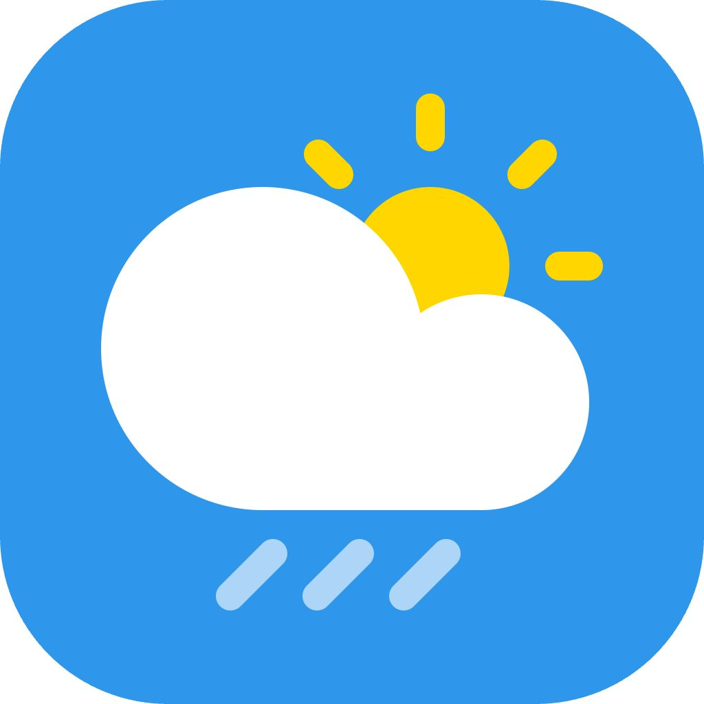

# Native Swift Apps

**Build. Learn. Explore.**

An open-source collection of native Swift and SwiftUI applications for Apple platforms,  
built to help developers learn Apple development through practical projects —  
plus a hand-picked list of open-source Swift apps from the community to explore.


[Overview](#overview)  ·   [Projects](#projects)  ·   [Roadmap](#roadmap)  ·   [Explore More](#explore-more)  ·   [Technology](#technology)  ·   [Getting Started](#getting-started)  ·   [Contributing](#contributing)

  


## Overview

Native Swift Apps is a growing collection of self-contained apps built with Swift and SwiftUI. Each project is a complete Xcode project with its own README, so you can learn by reading, running and extending working code.

- **Purpose** — Turn Apple platform concepts into practical, hands-on projects.
- **Audience** — Developers new to Swift, developers moving to Apple platforms from web or Android, and experienced engineers exploring specific frameworks.
- **Focus** — Native Apple development only: Swift, SwiftUI and first-party frameworks, with no third-party dependencies unless a project needs them.

Projects are grouped by difficulty — **Beginner**, **Intermediate** and **Advanced** — so you can start where you are and move up at your own pace.

Want more? [Explore More](#explore-more) lists 30 open-source Swift apps by other developers — from a menu bar Pomodoro timer to a Mastodon client — sorted by the same levels. They live in their own repositories; this repo only links to them.

  


## Projects

<table>
  <tr>
    <td width="56" align="center"><a href="calculator/"></a></td>
    <td>
      <a href="calculator/"><b>SwiftCalc</b></a>&nbsp;
      
      <br>
      <sub>Calculator, tip splitter and unit converter with scientific functions and history.</sub>
    </td>
    <td width="80" align="right"><a href="calculator/README.md"><sub>README&nbsp;→</sub></a></td>
  </tr>
  <tr>
    <td width="56" align="center"><a href="weather/"></a></td>
    <td>
      <a href="weather/"><b>Weather</b></a>&nbsp;
      
      <br>
      <sub>Live conditions, 14-day forecasts, air quality and a map, powered by Open-Meteo.</sub>
    </td>
    <td width="80" align="right"><a href="weather/README.md"><sub>README&nbsp;→</sub></a></td>
  </tr>
  <tr>
    <td width="56" align="center"><a href="Journal/"></a></td>
    <td>
      <a href="Journal/"><b>Journal</b></a>&nbsp;
      
      <br>
      <sub>Private journal with moods, checklists, photos, a calendar and insights.</sub>
    </td>
    <td width="80" align="right"><a href="Journal/README.md"><sub>README&nbsp;→</sub></a></td>
  </tr>
</table>

**SwiftCalc:** SwiftUI layout, `@Observable` state, `@AppStorage`, a hand-written expression parser, `Measurement` units, Swift Testing.  
**Weather:** `URLSession` with `async`/`await`, `Codable` JSON decoding, MapKit for SwiftUI, shared `@Observable` state, `UserDefaults` persistence.  
**Journal:** SwiftData models, Swift Charts mood trends, PhotosUI, LocalAuthentication, a custom masonry layout.

  


## Roadmap

These projects are planned and **not yet in the repository**. Names and scope may change; each will get its own folder and README when it lands.

|  SwiftUI fundamentals · Layouts · State |  Persistence · Networking · Native frameworks                                                         |  Concurrency · Multimedia · Architecture                                    |
| ------------------------------------------------------------------------------------------------------------------ | ---------------------------------------------------------------------------------------------------------------------------------------------------------------------------------------- | ------------------------------------------------------------------------------------------------------------------------------------------------------ |
| **TaskFlow** Task management **QuickNotes** Notes and organization **FocusTimer** Pomodoro timer                   | **Spendly** Expense tracking **HabitKit** Habit tracking **QRStudio** QR scanner and generator **VaultKey** Local password manager **Markdown Studio** Markdown editor with live preview | **SwiftChat** AI chat **PixelLab** Image editing **AudioWave** Music player and visualizer **FileNest** File management **Bookly** Appointment booking |

  


## Explore More

Open-source Swift apps by other developers, picked for learning: native Swift, open source, and maintained or worth reading as a reference. They live in their own repositories — **this repo only links to them** — and each keeps its own license, so check it before reusing code. Browse them with filters on the [explore hub](https://miftah-fentaw.github.io/Native_Swift_Apps/#/explore?source=community).

[Beginner](#beginner)  ·   [Intermediate](#intermediate)  ·   [Advanced](#advanced)  ·   [Suggest an app](CONTRIBUTING.md#suggesting-a-community-app)

<!-- explore-more:start -->
<!-- Generated from website/src/data/projects.ts by website/scripts/readme.ts. Edit the data, then run `npm run readme` in website/. -->

### Beginner

<table>
  <tr>
    <td width="56" align="center"><a href="https://github.com/jordansinger/SwiftUI-Kit"></a></td>
    <td>
      <a href="https://github.com/jordansinger/SwiftUI-Kit"><b>SwiftUI Kit</b></a>&nbsp;
      
      
      
      <br>
      <sub>Every standard SwiftUI control and interaction in one demo app.</sub>
    </td>
    <td width="80" align="right"><a href="https://github.com/jordansinger/SwiftUI-Kit"><sub>GitHub&nbsp;→</sub></a></td>
  </tr>
  <tr>
    <td width="56" align="center"><a href="https://github.com/twostraws/HackingWithSwift"></a></td>
    <td>
      <a href="https://github.com/twostraws/HackingWithSwift"><b>Hacking with Swift</b></a>&nbsp;
      
      
      
      <br>
      <sub>Source code for the Hacking with Swift tutorials, in UIKit and SwiftUI editions.</sub>
    </td>
    <td width="80" align="right"><a href="https://github.com/twostraws/HackingWithSwift"><sub>GitHub&nbsp;→</sub></a></td>
  </tr>
  <tr>
    <td width="56" align="center"><a href="https://github.com/ivoronin/TomatoBar"></a></td>
    <td>
      <a href="https://github.com/ivoronin/TomatoBar"><b>TomatoBar</b></a>&nbsp;
      
      
      
      <br>
      <sub>Pomodoro timer for the menu bar with sounds, notifications and a global hotkey.</sub>
    </td>
    <td width="80" align="right"><a href="https://github.com/ivoronin/TomatoBar"><sub>GitHub&nbsp;→</sub></a></td>
  </tr>
  <tr>
    <td width="56" align="center"><a href="https://github.com/dwarvesf/hidden"></a></td>
    <td>
      <a href="https://github.com/dwarvesf/hidden"><b>Hidden Bar</b></a>&nbsp;
      
      
      
      <br>
      <sub>Tiny utility that hides menu bar icons behind a toggle.</sub>
    </td>
    <td width="80" align="right"><a href="https://github.com/dwarvesf/hidden"><sub>GitHub&nbsp;→</sub></a></td>
  </tr>
  <tr>
    <td width="56" align="center"><a href="https://github.com/alfianlosari/NewsAppSwiftUI"></a></td>
    <td>
      <a href="https://github.com/alfianlosari/NewsAppSwiftUI"><b>News App</b></a>&nbsp;
      
      
      
      <br>
      <sub>News by category with search, bookmarks and widgets, built on NewsAPI.</sub>
    </td>
    <td width="80" align="right"><a href="https://github.com/alfianlosari/NewsAppSwiftUI"><sub>GitHub&nbsp;→</sub></a></td>
  </tr>
  <tr>
    <td width="56" align="center"><a href="https://github.com/sameersyd/Expenso-iOS"></a></td>
    <td>
      <a href="https://github.com/sameersyd/Expenso-iOS"><b>Expenso</b></a>&nbsp;
      
      
      
      <br>
      <sub>Income and expense tracker with charts, Face ID lock and CSV export.</sub>
    </td>
    <td width="80" align="right"><a href="https://github.com/sameersyd/Expenso-iOS"><sub>GitHub&nbsp;→</sub></a></td>
  </tr>
  <tr>
    <td width="56" align="center"><a href="https://github.com/alfianlosari/ChatGPTSwiftUI"></a></td>
    <td>
      <a href="https://github.com/alfianlosari/ChatGPTSwiftUI"><b>ChatGPT SwiftUI</b></a>&nbsp;
      
      
      
      <br>
      <sub>Chat client for the OpenAI API with Markdown and code highlighting.</sub>
    </td>
    <td width="80" align="right"><a href="https://github.com/alfianlosari/ChatGPTSwiftUI"><sub>GitHub&nbsp;→</sub></a></td>
  </tr>
</table>

**SwiftUI Kit:** How each built-in SwiftUI control looks and behaves, system colors and fonts, haptic feedback, changing an app’s accent color, one SwiftUI codebase on five platforms.  
**Hacking with Swift:** Swift and iOS basics, one small project at a time, UIKit and SpriteKit in the classic course, SwiftUI in the SwiftUI edition, going from a starter project to a finished app.  
**TomatoBar:** Building a menu bar app, modeling a timer as a set of states, actionable notifications, a global keyboard shortcut, custom URL schemes for automation, shipping a fully sandboxed app.  
**Hidden Bar:** Menu bar status items in AppKit, launch at login, saving user preferences, a small but complete macOS utility.  
**News App:** Structured concurrency with async/await and actors, AsyncImage, `.refreshable` and swipe actions, search with `.searchable` and suggestions, persisting bookmarks with an actor, configurable widgets, Watch Connectivity. *Needs a free API key from newsapi.org. Last updated in 2021, so some APIs are older.*  
**Expenso:** Saving and querying data with Core Data, MVVM in SwiftUI, spending charts, Face ID / Touch ID lock, exporting data as CSV.  
**ChatGPT SwiftUI:** Calling a chat API from Swift, rendering Markdown and highlighted code, sharing one codebase across four platforms. *Needs an OpenAI API key. Last updated in 2024.*

### Intermediate

<table>
  <tr>
    <td width="56" align="center"><a href="https://github.com/scastiel/kado"></a></td>
    <td>
      <a href="https://github.com/scastiel/kado"><b>Kadō</b></a>&nbsp;
      
      
      
      <br>
      <sub>Privacy-first habit tracker that scores habits instead of counting streaks.</sub>
    </td>
    <td width="80" align="right"><a href="https://github.com/scastiel/kado"><sub>GitHub&nbsp;→</sub></a></td>
  </tr>
  <tr>
    <td width="56" align="center"><a href="https://github.com/rafsoh/dimeApp"></a></td>
    <td>
      <a href="https://github.com/rafsoh/dimeApp"><b>Dime</b></a>&nbsp;
      
      
      
      <br>
      <sub>Expense tracker with budgets, recurring expenses, iCloud sync and widgets.</sub>
    </td>
    <td width="80" align="right"><a href="https://github.com/rafsoh/dimeApp"><sub>GitHub&nbsp;→</sub></a></td>
  </tr>
  <tr>
    <td width="56" align="center"><a href="https://github.com/brillcp/PocketDex"></a></td>
    <td>
      <a href="https://github.com/brillcp/PocketDex"><b>PocketDex+</b></a>&nbsp;
      
      
      
      <br>
      <sub>Pokédex on PokeAPI with turn-based battles and nearby multiplayer.</sub>
    </td>
    <td width="80" align="right"><a href="https://github.com/brillcp/PocketDex"><sub>GitHub&nbsp;→</sub></a></td>
  </tr>
  <tr>
    <td width="56" align="center"><a href="https://github.com/weiran/Hackers"></a></td>
    <td>
      <a href="https://github.com/weiran/Hackers"><b>Hackers</b></a>&nbsp;
      
      
      
      <br>
      <sub>Hacker News reader with threaded comments, voting, bookmarks and search.</sub>
    </td>
    <td width="80" align="right"><a href="https://github.com/weiran/Hackers"><sub>GitHub&nbsp;→</sub></a></td>
  </tr>
  <tr>
    <td width="56" align="center"><a href="https://github.com/gluonfield/enchanted"></a></td>
    <td>
      <a href="https://github.com/gluonfield/enchanted"><b>Enchanted</b></a>&nbsp;
      
      
      
      <br>
      <sub>Chat app for self-hosted language models through Ollama.</sub>
    </td>
    <td width="80" align="right"><a href="https://github.com/gluonfield/enchanted"><sub>GitHub&nbsp;→</sub></a></td>
  </tr>
  <tr>
    <td width="56" align="center"><a href="https://github.com/apple/sample-food-truck"></a></td>
    <td>
      <a href="https://github.com/apple/sample-food-truck"><b>Food Truck</b></a>&nbsp;
      
      
      
      <br>
      <sub>Apple’s WWDC22 multiplatform sample for running a food truck business.</sub>
    </td>
    <td width="80" align="right"><a href="https://github.com/apple/sample-food-truck"><sub>GitHub&nbsp;→</sub></a></td>
  </tr>
  <tr>
    <td width="56" align="center"><a href="https://github.com/apple/sample-backyard-birds"></a></td>
    <td>
      <a href="https://github.com/apple/sample-backyard-birds"><b>Backyard Birds</b></a>&nbsp;
      
      
      
      <br>
      <sub>Apple’s WWDC23 sample game about the birds that visit your garden.</sub>
    </td>
    <td width="80" align="right"><a href="https://github.com/apple/sample-backyard-birds"><sub>GitHub&nbsp;→</sub></a></td>
  </tr>
  <tr>
    <td width="56" align="center"><a href="https://github.com/p0deje/Maccy"></a></td>
    <td>
      <a href="https://github.com/p0deje/Maccy"><b>Maccy</b></a>&nbsp;
      
      
      
      <br>
      <sub>Keyboard-first clipboard manager with search.</sub>
    </td>
    <td width="80" align="right"><a href="https://github.com/p0deje/Maccy"><sub>GitHub&nbsp;→</sub></a></td>
  </tr>
  <tr>
    <td width="56" align="center"><a href="https://github.com/twostraws/ControlRoom"></a></td>
    <td>
      <a href="https://github.com/twostraws/ControlRoom"><b>Control Room</b></a>&nbsp;
      
      
      
      <br>
      <sub>Controls the Xcode simulators: status bar, appearance, screenshots and more.</sub>
    </td>
    <td width="80" align="right"><a href="https://github.com/twostraws/ControlRoom"><sub>GitHub&nbsp;→</sub></a></td>
  </tr>
  <tr>
    <td width="56" align="center"><a href="https://github.com/analogcode/Swift-Radio-Pro"></a></td>
    <td>
      <a href="https://github.com/analogcode/Swift-Radio-Pro"><b>Swift Radio</b></a>&nbsp;
      
      
      
      <br>
      <sub>Internet radio station app with CarPlay, ready to rebrand with your own stations.</sub>
    </td>
    <td width="80" align="right"><a href="https://github.com/analogcode/Swift-Radio-Pro"><sub>GitHub&nbsp;→</sub></a></td>
  </tr>
  <tr>
    <td width="56" align="center"><a href="https://github.com/Dimillian/MovieSwiftUI"></a></td>
    <td>
      <a href="https://github.com/Dimillian/MovieSwiftUI"><b>MovieSwiftUI</b></a>&nbsp;
      
      
      
      <br>
      <sub>Movie browser for The Movie Database with a custom Redux-style store.</sub>
    </td>
    <td width="80" align="right"><a href="https://github.com/Dimillian/MovieSwiftUI"><sub>GitHub&nbsp;→</sub></a></td>
  </tr>
  <tr>
    <td width="56" align="center"><a href="https://github.com/mattrubin/Authenticator"></a></td>
    <td>
      <a href="https://github.com/mattrubin/Authenticator"><b>Authenticator</b></a>&nbsp;
      
      
      
      <br>
      <sub>Two-factor authentication codes, set up by scanning a QR code.</sub>
    </td>
    <td width="80" align="right"><a href="https://github.com/mattrubin/Authenticator"><sub>GitHub&nbsp;→</sub></a></td>
  </tr>
</table>

**Kadō:** `@Observable` state, SwiftData storage, optional sync with a CloudKit private database, home screen widgets, App Intents, JSON and CSV export.  
**Dime:** Category budgets and recurring expenses, syncing data through iCloud, home and lock screen widgets, a biometric lock, home screen quick actions, reminder notifications.  
**PocketDex+:** Swift 6 strict concurrency and actors, SwiftData with a background `@ModelActor`, decoding JSON off the main thread, protocol-oriented MVVM with a composition root, local multiplayer with MultipeerConnectivity.  
**Hackers:** Splitting an app into Swift package modules, collapsible nested comment threads, a share extension, Dynamic Type and VoiceOver, testing module by module.  
**Enchanted:** A chat UI for a local LLM server, rendering Markdown tables and code, image attachments in prompts, voice input and text to speech, storing conversation history on device. *Needs your own Ollama server. The author continues this work in a newer project, Jaz.*  
**Food Truck:** NavigationSplitView, a custom Layout, trends with Swift Charts, weather data with WeatherKit, Live Activities and the Dynamic Island.  
**Backyard Birds:** Modeling data with SwiftData, Observation with SwiftUI, interactive and configurable widgets with App Intents, in-app purchases with ProductView and SubscriptionStoreView.  
**Maccy:** Watching NSPasteboard for changes, storing history with SwiftData, global keyboard shortcuts, building a menu bar app, keyboard-first search.  
**Control Room:** SwiftUI on macOS, running command-line tools from an app, wrapping a command-line tool in a native UI. *Needs Xcode installed, because it runs simctl.*  
**Swift Radio:** Streaming audio in the background, lock screen and Control Center controls, a CarPlay interface, loading stations from a local or remote JSON file, Swift 6 complete concurrency checking.  
**MovieSwiftUI:** Unidirectional data flow with a Redux-style store, Combine, networking with a public REST API, structuring a larger SwiftUI app. *Last updated in 2024, so some SwiftUI APIs are older.*  
**Authenticator:** Generating time-based one-time passwords, QR code setup, handling otpauth:// URLs, storing secrets securely on device.

### Advanced

<table>
  <tr>
    <td width="56" align="center"><a href="https://github.com/Dimillian/IceCubesApp"></a></td>
    <td>
      <a href="https://github.com/Dimillian/IceCubesApp"><b>Ice Cubes</b></a>&nbsp;
      
      
      
      <br>
      <sub>Mastodon client built entirely in SwiftUI.</sub>
    </td>
    <td width="80" align="right"><a href="https://github.com/Dimillian/IceCubesApp"><sub>GitHub&nbsp;→</sub></a></td>
  </tr>
  <tr>
    <td width="56" align="center"><a href="https://github.com/pointfreeco/isowords"></a></td>
    <td>
      <a href="https://github.com/pointfreeco/isowords"><b>isowords</b></a>&nbsp;
      
      
      
      <br>
      <sub>Word search game on a vanishing cube, with client and server in Swift.</sub>
    </td>
    <td width="80" align="right"><a href="https://github.com/pointfreeco/isowords"><sub>GitHub&nbsp;→</sub></a></td>
  </tr>
  <tr>
    <td width="56" align="center"><a href="https://github.com/nalexn/clean-architecture-swiftui"></a></td>
    <td>
      <a href="https://github.com/nalexn/clean-architecture-swiftui"><b>Clean Architecture SwiftUI</b></a>&nbsp;
      
      
      
      <br>
      <sub>Sample app that shows Clean Architecture end to end.</sub>
    </td>
    <td width="80" align="right"><a href="https://github.com/nalexn/clean-architecture-swiftui"><sub>GitHub&nbsp;→</sub></a></td>
  </tr>
  <tr>
    <td width="56" align="center"><a href="https://github.com/Ranchero-Software/NetNewsWire"></a></td>
    <td>
      <a href="https://github.com/Ranchero-Software/NetNewsWire"><b>NetNewsWire</b></a>&nbsp;
      
      
      
      <br>
      <sub>Fast, free RSS reader for Mac, iPhone and iPad.</sub>
    </td>
    <td width="80" align="right"><a href="https://github.com/Ranchero-Software/NetNewsWire"><sub>GitHub&nbsp;→</sub></a></td>
  </tr>
  <tr>
    <td width="56" align="center"><a href="https://github.com/element-hq/element-x-ios"></a></td>
    <td>
      <a href="https://github.com/element-hq/element-x-ios"><b>Element X</b></a>&nbsp;
      
      
      
      <br>
      <sub>Matrix chat client in SwiftUI, built on the Matrix Rust SDK.</sub>
    </td>
    <td width="80" align="right"><a href="https://github.com/element-hq/element-x-ios"><sub>GitHub&nbsp;→</sub></a></td>
  </tr>
  <tr>
    <td width="56" align="center"><a href="https://github.com/bitwarden/ios"></a></td>
    <td>
      <a href="https://github.com/bitwarden/ios"><b>Bitwarden</b></a>&nbsp;
      
      
      
      <br>
      <sub>The official Bitwarden password manager and authenticator apps.</sub>
    </td>
    <td width="80" align="right"><a href="https://github.com/bitwarden/ios"><sub>GitHub&nbsp;→</sub></a></td>
  </tr>
  <tr>
    <td width="56" align="center"><a href="https://github.com/permissionlesstech/bitchat"></a></td>
    <td>
      <a href="https://github.com/permissionlesstech/bitchat"><b>bitchat</b></a>&nbsp;
      
      
      
      <br>
      <sub>Peer-to-peer chat over a Bluetooth mesh, with Nostr when online.</sub>
    </td>
    <td width="80" align="right"><a href="https://github.com/permissionlesstech/bitchat"><sub>GitHub&nbsp;→</sub></a></td>
  </tr>
  <tr>
    <td width="56" align="center"><a href="https://github.com/jellyfin/Swiftfin"></a></td>
    <td>
      <a href="https://github.com/jellyfin/Swiftfin"><b>Swiftfin</b></a>&nbsp;
      
      
      
      <br>
      <sub>Jellyfin media server client for iPhone, iPad and Apple TV.</sub>
    </td>
    <td width="80" align="right"><a href="https://github.com/jellyfin/Swiftfin"><sub>GitHub&nbsp;→</sub></a></td>
  </tr>
  <tr>
    <td width="56" align="center"><a href="https://github.com/Automattic/pocket-casts-ios"></a></td>
    <td>
      <a href="https://github.com/Automattic/pocket-casts-ios"><b>Pocket Casts</b></a>&nbsp;
      
      
      
      <br>
      <sub>Full-featured podcast player.</sub>
    </td>
    <td width="80" align="right"><a href="https://github.com/Automattic/pocket-casts-ios"><sub>GitHub&nbsp;→</sub></a></td>
  </tr>
  <tr>
    <td width="56" align="center"><a href="https://github.com/CodeEditApp/CodeEdit"></a></td>
    <td>
      <a href="https://github.com/CodeEditApp/CodeEdit"><b>CodeEdit</b></a>&nbsp;
      
      
      
      <br>
      <sub>Native code editor for macOS.</sub>
    </td>
    <td width="80" align="right"><a href="https://github.com/CodeEditApp/CodeEdit"><sub>GitHub&nbsp;→</sub></a></td>
  </tr>
  <tr>
    <td width="56" align="center"><a href="https://github.com/kushalpandya/Petrichor"></a></td>
    <td>
      <a href="https://github.com/kushalpandya/Petrichor"><b>Petrichor</b></a>&nbsp;
      
      
      
      <br>
      <sub>Offline music player with smart playlists, synced lyrics and gapless playback.</sub>
    </td>
    <td width="80" align="right"><a href="https://github.com/kushalpandya/Petrichor"><sub>GitHub&nbsp;→</sub></a></td>
  </tr>
</table>

**Ice Cubes:** Splitting features into Swift packages, live updates from a streaming API, a sidebar layout for iPad and Mac, one SwiftUI codebase on four platforms.  
**isowords:** The Composable Architecture at scale, mixing SwiftUI with SceneKit, a server written in Swift, testing a large modular app.  
**Clean Architecture SwiftUI:** Separating UI, business logic and data access, dependency injection, SwiftData persistence, networking, unit testing.  
**NetNewsWire:** A mature AppKit and UIKit codebase, feed parsing for RSS, Atom and JSON Feed, syncing with feed services, sharing code between Mac and iOS.  
**Element X:** Calling a Rust SDK from Swift through a Swift package, SwiftUI in a large production app, end-to-end encrypted messaging, sharing core logic with an Android app.  
**Bitwarden:** A password AutoFill extension, share and action extensions, an Apple Watch companion app, generating Xcode projects from YAML specs, unit and view testing at scale.  
**bitchat:** Bluetooth LE mesh networking with CoreBluetooth, multi-hop message relay, end-to-end encryption with the Noise Protocol, choosing between offline and internet transports.  
**Swiftfin:** Video playback, a focus-based tvOS interface, a large SwiftUI app talking to a REST API, sharing code between iOS and tvOS. *Needs a Jellyfin server to connect to.*  
**Pocket Casts:** Audio playback and downloads, home screen widgets, Siri intents, an Apple Watch app, an App Clip, organizing a large app into modules.  
**CodeEdit:** Mixing AppKit and SwiftUI, a custom source editor with tree-sitter highlighting, an integrated terminal, source control integration.  
**Petrichor:** Gapless playback with crossfade and an equalizer, scanning a music library and reading metadata, smart playlists with rules, menu bar and Dock playback controls, Shortcuts and Siri automation.
<!-- explore-more:end -->

  


## Technology

What the projects in this repository use today:

| Technology | Used for |
| :--- | :--- |
| **Swift** | All app and test code |
| **SwiftUI** | User interfaces |
| **Observation** | `@Observable` app state |
| **Foundation** | Formatting, `Measurement` unit conversion, `UserDefaults` storage, `Codable` JSON |
| **URLSession** | Networking with `async`/`await` (Weather) |
| **MapKit** | Maps in SwiftUI (Weather) |
| **SwiftData** | On-device journal entries (Journal) |
| **Swift Charts** | Mood trends (Journal) |
| **PhotosUI** | Entry and profile photos (Journal) |
| **LocalAuthentication** | Face ID or passcode lock (Journal) |
| **UserNotifications** | Daily writing reminder (Journal) |
| **Swift Testing** | Unit tests |
| **XCTest** | UI and launch tests |

Each project's README lists its exact requirements. New frameworks will be added here as projects that use them are added.

  


## Getting Started

Clone the repository, then open a project folder in Xcode.

```bash
git clone https://github.com/Miftah-Fentaw/Native_Swift_Apps.git
```

Each project's README covers its requirements, setup, features and architecture. Start with [SwiftCalc](calculator/README.md), [Weather](weather/README.md), or [Journal](Journal/README.md). Community apps are cloned from their own repositories — follow the links in [Explore More](#explore-more).

### Explore hub website

[`website/`](website/) is a React site that lists every project — and every community app in [Explore More](#explore-more) — with screenshots, features, technology, search and filters for level, platform and source. It's published at **[miftah-fentaw.github.io/Native_Swift_Apps](https://miftah-fentaw.github.io/Native_Swift_Apps/)**. See its [README](website/README.md) to run it locally.

  


## Contributing

Contributions are welcome — bug fixes, improvements, documentation, new ideas and [community app suggestions](CONTRIBUTING.md#suggesting-a-community-app) alike.

Please read [CONTRIBUTING.md](CONTRIBUTING.md) and the [Code of Conduct](CODE_OF_CONDUCT.md) before opening an issue or pull request. To report a security issue, follow the [Security Policy](SECURITY.md).

  


## License

This repository is released under the [MIT License](LICENSE).

  


---

**Native Swift Apps** — Build. Learn. Explore.  
Explore the projects, contribute, and star the repository if it helps you learn.
