<a id="top"></a>

<div align="center">

<a href="https://miftah-fentaw.github.io/Native_Swift_Apps/">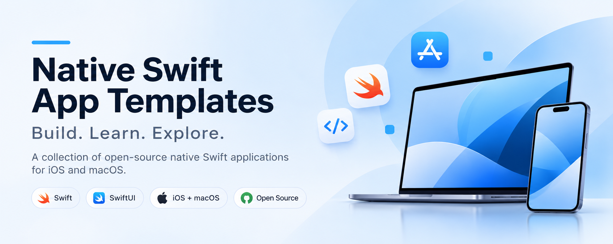</a>

<h1>Native Swift Apps</h1>

<p><b>Learn Swift and SwiftUI from complete, open-source apps — not snippets.</b><br>
<sub>Real Xcode projects you can clone, run and take apart, a hand-picked list of community apps, and an explore hub that ties it all together.</sub></p>

<p>


<a href="LICENSE"></a>
<br>
<a href="https://github.com/Miftah-Fentaw/Native_Swift_Apps/stargazers"></a>
<a href="https://github.com/Miftah-Fentaw/Native_Swift_Apps/commits/main"></a>
<a href="https://github.com/Miftah-Fentaw/Native_Swift_Apps/actions/workflows/ci.yml"></a>
<a href="CONTRIBUTING.md"></a>
</p>

<h3><a href="https://miftah-fentaw.github.io/Native_Swift_Apps/">🌐 Open the explore hub →</a></h3>

<!-- hub-stats:start -->
<!-- Generated by website/scripts/readme.ts (hub-stats). Edit the website data, then run `npm run readme` in website/. -->

<p align="center">
<a href="https://miftah-fentaw.github.io/Native_Swift_Apps/#/explore?source=repo"></a>
<a href="https://miftah-fentaw.github.io/Native_Swift_Apps/#/explore?source=community"></a>
<a href="https://miftah-fentaw.github.io/Native_Swift_Apps/#/patterns"></a>
<a href="https://miftah-fentaw.github.io/Native_Swift_Apps/#/learn"></a>
<a href="https://miftah-fentaw.github.io/Native_Swift_Apps/#/gallery"></a>
<a href="https://miftah-fentaw.github.io/Native_Swift_Apps/#/glossary"></a>
</p>

<!-- hub-stats:end -->

<p>
<a href="#why">Why</a> ·
<a href="#apps">Apps</a> ·
<a href="#learning-path">Learning path</a> ·
<a href="#patterns">Code patterns</a> ·
<a href="#explore-hub">Explore hub</a> ·
<a href="#explore-more">Explore More</a> ·
<a href="#roadmap">Roadmap</a> ·
<a href="#getting-started">Getting started</a> ·
<a href="#contributing">Contributing</a>
</p>

</div>

<br>

<a id="why"></a>

## ✨ Why Native Swift Apps

Tutorials stop where real apps get interesting: settings that persist, network requests that race, data that has to survive a relaunch, screens that work in dark mode and on iPad. Every project here is a **whole app** — onboarding, settings, tests and a README included — so you learn from code that actually ships.

<table>
  <tr>
    <td width="33%" valign="top">
      <h4>🍎 Native only</h4>
      Swift, SwiftUI and Apple's own frameworks. No third-party packages, so every line you read is the real API.
    </td>
    <td width="33%" valign="top">
      <h4>📈 Every level</h4>
      Apps are tagged <b>Beginner</b>, <b>Intermediate</b> or <b>Advanced</b>, and learning tracks put them in order for you.
    </td>
    <td width="33%" valign="top">
      <h4>🔍 Read the why</h4>
      Code patterns explain the reasoning behind the code, cut straight from the source so they never go stale.
    </td>
  </tr>
  <tr>
    <td width="33%" valign="top">
      <h4>🧪 Tested</h4>
      Each app has unit and UI test targets. SwiftCalc's parser is covered with Swift Testing.
    </td>
    <td width="33%" valign="top">
      <h4>🌍 Community picks</h4>
      30 hand-picked open-source Swift apps by other developers, from a menu bar timer to a Mastodon client.
    </td>
    <td width="33%" valign="top">
      <h4>🆓 Open source</h4>
      MIT licensed. Clone it, take it apart, and ship something of your own with it.
    </td>
  </tr>
</table>

**Who it's for:** developers new to Swift, developers moving to Apple platforms from the web or Android, and experienced engineers who want a working example of one specific framework.

<p align="right"><sub><a href="#top">Back to top ↑</a></sub></p>

<a id="apps"></a>

## 📱 The apps

<table>
  <tr>
    <td width="72" valign="top"><a href="calculator/">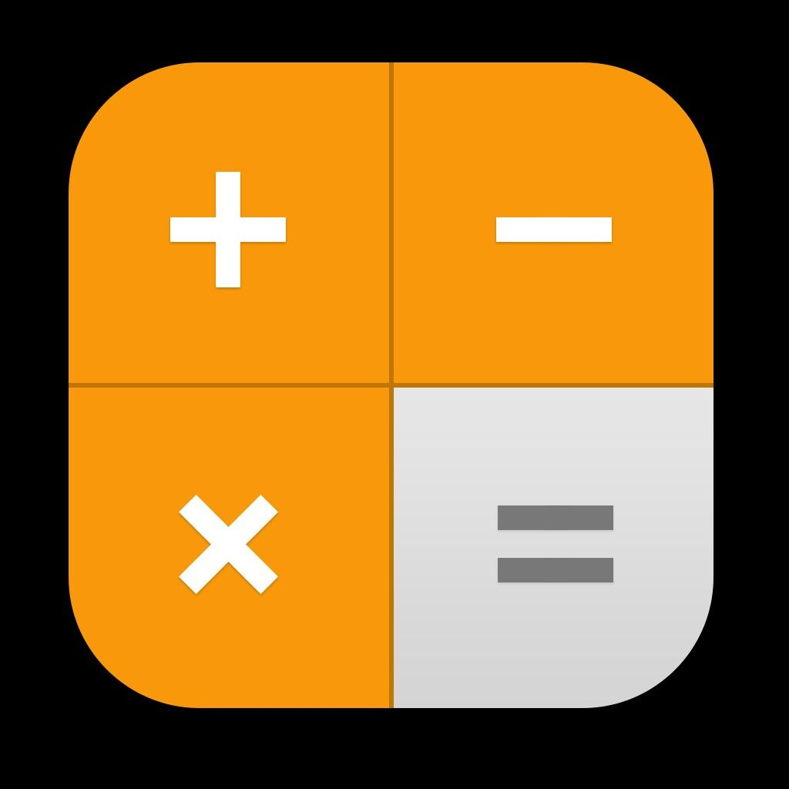</a></td>
    <td valign="top">
      <h3><a href="calculator/">SwiftCalc</a></h3>
      
      
      
      <p>A standard and scientific calculator with live results, memory and history, a tip splitter and an eight-category unit converter — all behind one mode switcher.</p>
      <sub><b>You'll learn:</b> SwiftUI layout, <code>@Observable</code> state, <code>@AppStorage</code> settings, a recursive-descent expression parser, <code>Measurement</code> unit conversion and Swift Testing.</sub><br>
      <sub><a href="calculator/README.md">README</a> · <a href="https://miftah-fentaw.github.io/Native_Swift_Apps/#/projects/swiftcalc">Project page</a> · <a href="https://miftah-fentaw.github.io/Native_Swift_Apps/#/patterns?app=swiftcalc">Code patterns</a></sub>
    </td>
  </tr>
</table>

<p align="center">
  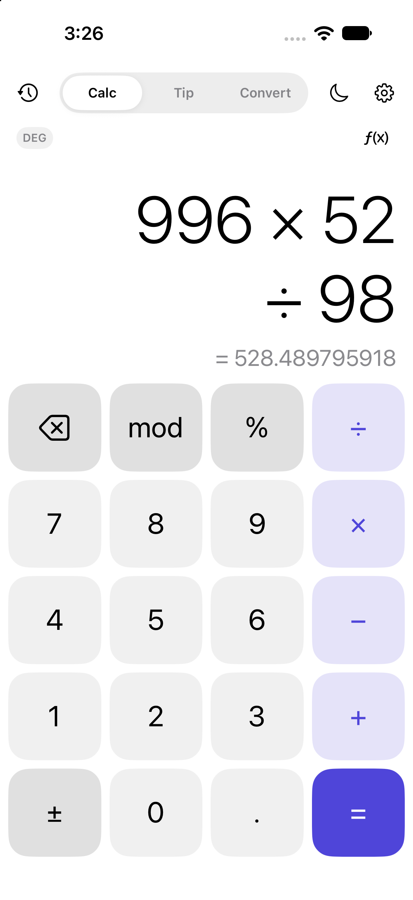&nbsp;
  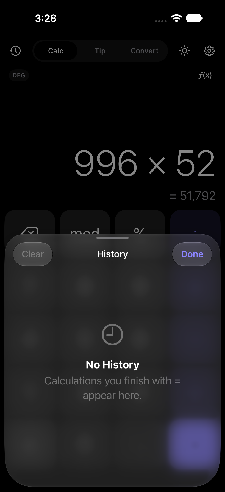&nbsp;
  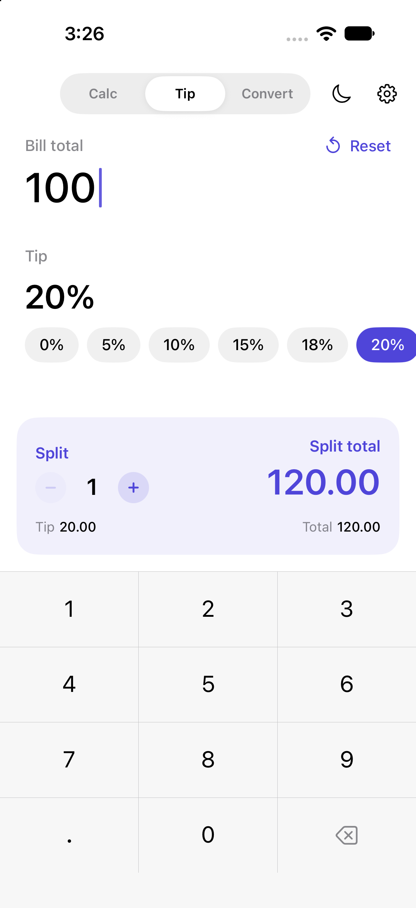&nbsp;
  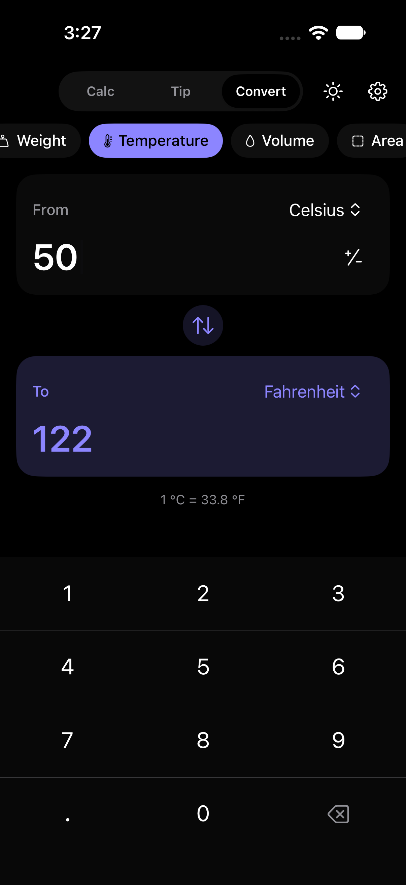
</p>

<table>
  <tr>
    <td width="72" valign="top"><a href="weather/"></a></td>
    <td valign="top">
      <h3><a href="weather/">Weather</a></h3>
      
      
      
      <p>A four-tab weather app powered by the free Open-Meteo APIs: current conditions in the city's own time zone, hourly, 7-day and 14-day forecasts, air quality, a map and saved favorites.</p>
      <sub><b>You'll learn:</b> <code>URLSession</code> with <code>async</code>/<code>await</code>, parallel requests with <code>async let</code>, <code>Codable</code> with explicit <code>CodingKeys</code>, a shared <code>@Observable</code> store, <code>UserDefaults</code> persistence and MapKit for SwiftUI.</sub><br>
      <sub><a href="weather/README.md">README</a> · <a href="https://miftah-fentaw.github.io/Native_Swift_Apps/#/projects/weather">Project page</a> · <a href="https://miftah-fentaw.github.io/Native_Swift_Apps/#/patterns?app=weather">Code patterns</a></sub>
    </td>
  </tr>
</table>

<p align="center">
  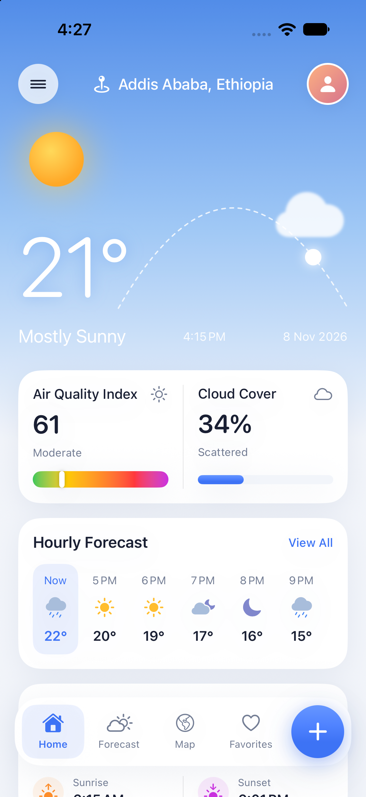&nbsp;
  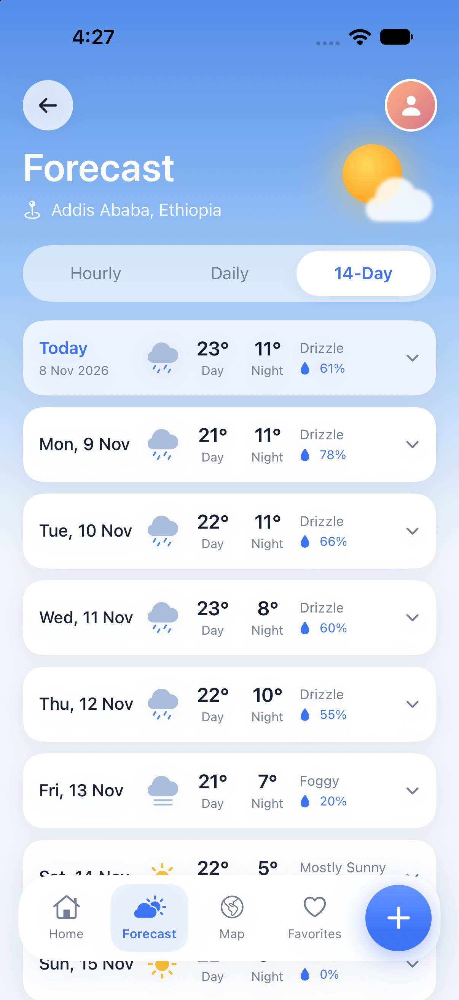&nbsp;
  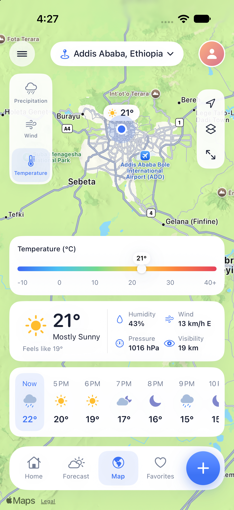&nbsp;
  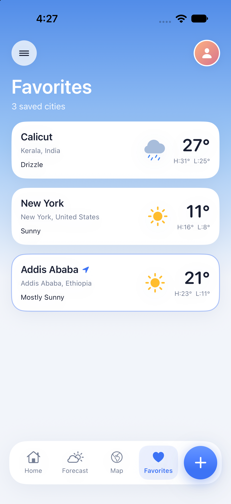
</p>

<table>
  <tr>
    <td width="72" valign="top"><a href="Journal/"></a></td>
    <td valign="top">
      <h3><a href="Journal/">Journal</a></h3>
      
      
      
      <p>A private journal where entries mix text, a checklist and a photo, stored on device with SwiftData — with a calendar, mood insights, search, onboarding, a daily reminder and a Face ID lock.</p>
      <sub><b>You'll learn:</b> SwiftData models and <code>@Query</code>, Swift Charts, PhotosUI, LocalAuthentication, local notifications and a custom masonry <code>Layout</code>.</sub><br>
      <sub><a href="Journal/README.md">README</a> · <a href="https://miftah-fentaw.github.io/Native_Swift_Apps/#/projects/journal">Project page</a> · <a href="https://miftah-fentaw.github.io/Native_Swift_Apps/#/patterns?app=journal">Code patterns</a></sub>
    </td>
  </tr>
</table>

<p align="center">
  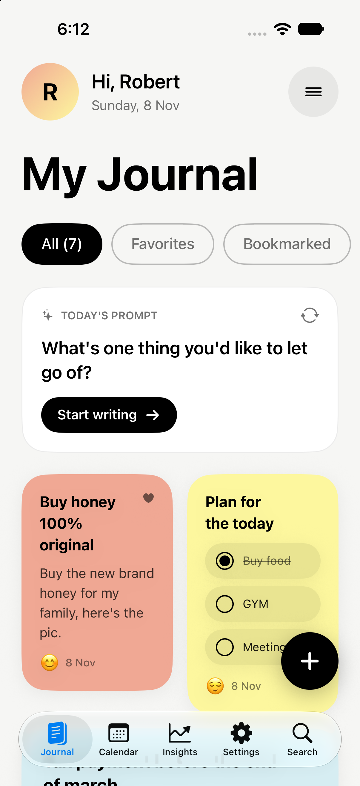&nbsp;
  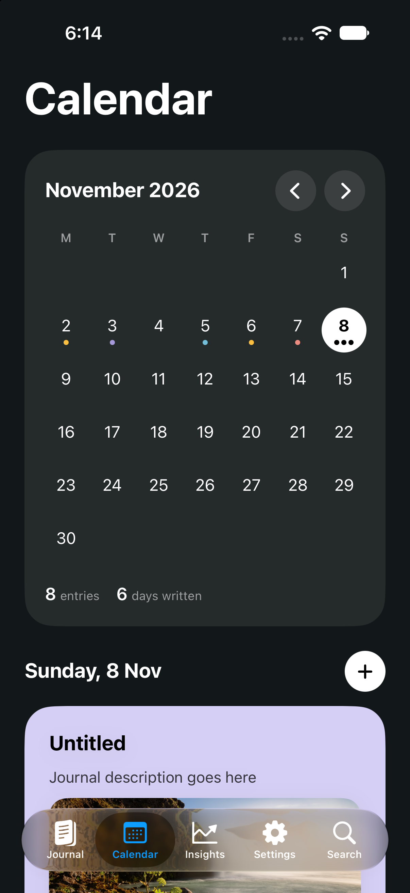&nbsp;
  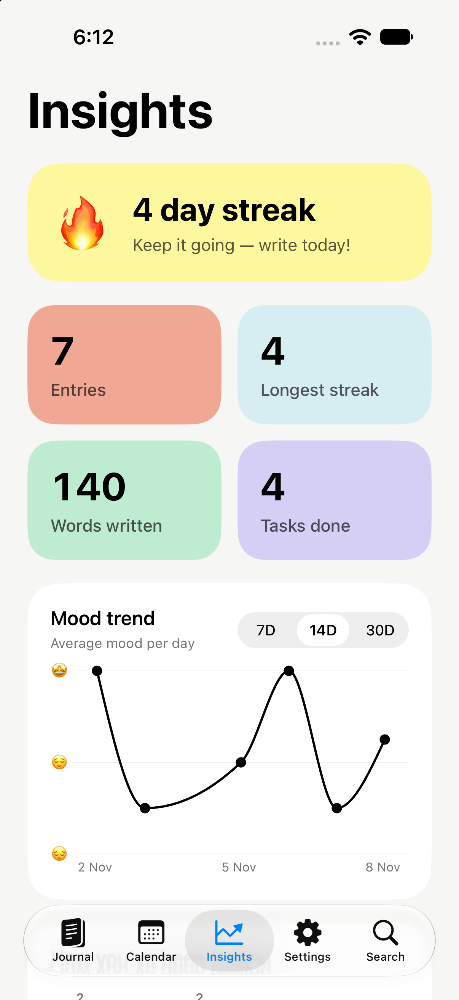&nbsp;
  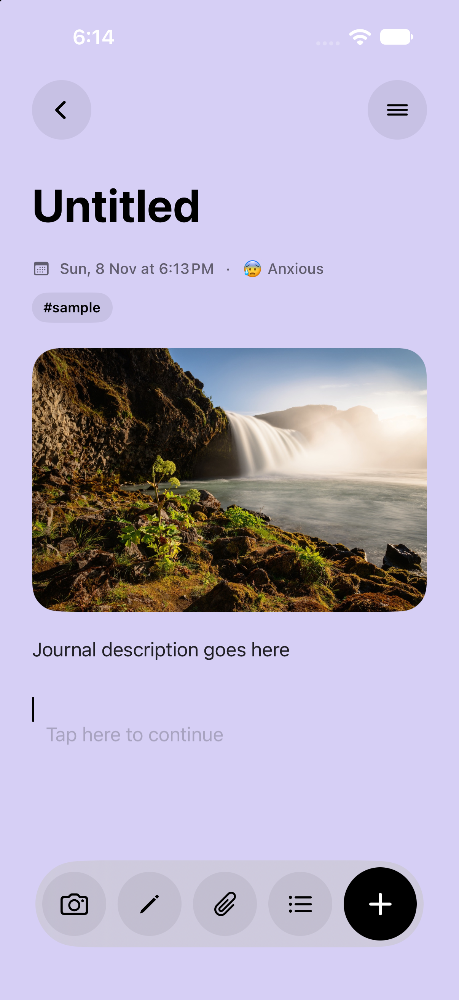
</p>

<p align="center"><sub>Every screenshot, in light and dark: <a href="https://miftah-fentaw.github.io/Native_Swift_Apps/#/gallery">the gallery →</a></sub></p>

<a id="what-each-app-uses"></a>

### 🧩 What each app uses

<!-- feature-matrix:start -->
<!-- Generated by website/scripts/readme.ts (feature-matrix). Edit the website data, then run `npm run readme` in website/. -->

| | [**SwiftCalc**](calculator/) | [**Weather**](weather/) | [**Journal**](Journal/) |
| :--- | :---: | :---: | :---: |
| *Level* | 🟢 Beginner | 🟢 Beginner | 🟠 Intermediate |
| [Swift](https://miftah-fentaw.github.io/Native_Swift_Apps/#/topics/swift) | ✅ | ✅ | ✅ |
| [SwiftUI](https://miftah-fentaw.github.io/Native_Swift_Apps/#/topics/swiftui) | ✅ | ✅ | ✅ |
| [Observation](https://miftah-fentaw.github.io/Native_Swift_Apps/#/topics/observation) | ✅ | ✅ | · |
| [SwiftData](https://miftah-fentaw.github.io/Native_Swift_Apps/#/topics/swiftdata) | · | · | ✅ |
| [Foundation](https://miftah-fentaw.github.io/Native_Swift_Apps/#/topics/foundation) | ✅ | ✅ | ✅ |
| [LocalAuthentication](https://miftah-fentaw.github.io/Native_Swift_Apps/#/topics/localauthentication) | · | · | ✅ |
| [XCTest](https://miftah-fentaw.github.io/Native_Swift_Apps/#/topics/xctest) | ✅ | ✅ | ✅ |
| [Swift Charts](https://miftah-fentaw.github.io/Native_Swift_Apps/#/topics/swift-charts) | · | · | ✅ |
| [UserNotifications](https://miftah-fentaw.github.io/Native_Swift_Apps/#/topics/usernotifications) | · | · | ✅ |
| [MapKit](https://miftah-fentaw.github.io/Native_Swift_Apps/#/topics/mapkit) | · | ✅ | · |
| [PhotosUI](https://miftah-fentaw.github.io/Native_Swift_Apps/#/topics/photosui) | · | · | ✅ |
| [Swift Testing](https://miftah-fentaw.github.io/Native_Swift_Apps/#/topics/swift-testing) | ✅ | · | · |
| [URLSession](https://miftah-fentaw.github.io/Native_Swift_Apps/#/topics/urlsession) | · | ✅ | · |
| *Screenshots* | 8 | 6 | 14 |
| *Code patterns* | [6](https://miftah-fentaw.github.io/Native_Swift_Apps/#/patterns?app=swiftcalc) | [6](https://miftah-fentaw.github.io/Native_Swift_Apps/#/patterns?app=weather) | [8](https://miftah-fentaw.github.io/Native_Swift_Apps/#/patterns?app=journal) |

<!-- feature-matrix:end -->

<p align="right"><sub><a href="#top">Back to top ↑</a></sub></p>

<a id="learning-path"></a>

## 🧭 Learning path

Start with a Beginner app, move up a level when it feels easy, and use the community apps to see the same ideas at a bigger scale.

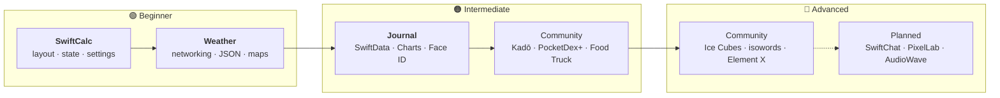

**Learning tracks** order real apps around one topic, from first step to advanced. Each step on the website says what to look at in that app.

<!-- learning-tracks:start -->
<!-- Generated by website/scripts/readme.ts (learning-tracks). Edit the website data, then run `npm run readme` in website/. -->

| Track | Level | The path |
| :--- | :--- | :--- |
| [SwiftUI foundations](https://miftah-fentaw.github.io/Native_Swift_Apps/#/learn?t=swiftui-foundations) | 🟢 Beginner | SwiftUI Kit → **SwiftCalc** → Hacking with Swift → **Weather** → **Journal** |
| [Saving data](https://miftah-fentaw.github.io/Native_Swift_Apps/#/learn?t=saving-data) | 🟢 Beginner | **SwiftCalc** → **Weather** → **Journal** → Expenso → Kadō → Backyard Birds |
| [Networking and concurrency](https://miftah-fentaw.github.io/Native_Swift_Apps/#/learn?t=networking-concurrency) | 🟠 Intermediate | **Weather** → News App → PocketDex+ → Swift Radio → Ice Cubes |
| [Apple frameworks tour](https://miftah-fentaw.github.io/Native_Swift_Apps/#/learn?t=apple-frameworks) | 🟠 Intermediate | **Weather** → **Journal** → Food Truck → Backyard Birds → Dime → PocketDex+ → bitchat |
| [One codebase, every Apple device](https://miftah-fentaw.github.io/Native_Swift_Apps/#/learn?t=multiplatform) | 🟠 Intermediate | SwiftUI Kit → ChatGPT SwiftUI → Food Truck → Backyard Birds → Swiftfin → Ice Cubes → Enchanted |
| [Building for the Mac](https://miftah-fentaw.github.io/Native_Swift_Apps/#/learn?t=mac-apps) | 🟠 Intermediate | TomatoBar → Hidden Bar → Maccy → Control Room → Petrichor → CodeEdit → NetNewsWire |
| [Audio and video](https://miftah-fentaw.github.io/Native_Swift_Apps/#/learn?t=media) | 🔴 Advanced | Swift Radio → Petrichor → Pocket Casts → Swiftfin |
| [Chat, messaging and AI](https://miftah-fentaw.github.io/Native_Swift_Apps/#/learn?t=chat-and-ai) | 🔴 Advanced | ChatGPT SwiftUI → Enchanted → Element X → bitchat |
| [Architecture at scale](https://miftah-fentaw.github.io/Native_Swift_Apps/#/learn?t=architecture) | 🔴 Advanced | MovieSwiftUI → Clean Architecture SwiftUI → Hackers → isowords → Ice Cubes → Element X → Bitwarden |
| [Testing your code](https://miftah-fentaw.github.io/Native_Swift_Apps/#/learn?t=testing) | 🔴 Advanced | **SwiftCalc** → Clean Architecture SwiftUI → Hackers → isowords → Bitwarden |

<sub>**Bold** apps are in this repository; the rest are [community apps](#explore-more). Each step on the [Learn page](https://miftah-fentaw.github.io/Native_Swift_Apps/#/learn) says what to look at.</sub>

<!-- learning-tracks:end -->

<p align="right"><sub><a href="#top">Back to top ↑</a></sub></p>

<a id="patterns"></a>

## 💡 Code patterns

Short, explained excerpts from the apps — the parts worth copying. The website cuts each one from the Swift source when it's built, so they always match this repository, and the build fails if an excerpt's code moves.

<!-- code-patterns:start -->
<!-- Generated by website/scripts/readme.ts (code-patterns). Edit the website data, then run `npm run readme` in website/. -->

| Pattern | App | Frameworks |
| :--- | :--- | :--- |
| [A recursive-descent parser for operator precedence](https://miftah-fentaw.github.io/Native_Swift_Apps/#/patterns?p=recursive-descent) | SwiftCalc | Swift |
| [Computed values on an `@Observable` model](https://miftah-fentaw.github.io/Native_Swift_Apps/#/patterns?p=observable-model) | SwiftCalc | Observation, Swift |
| [Unit conversion with Foundation’s Measurement](https://miftah-fentaw.github.io/Native_Swift_Apps/#/patterns?p=measurement) | SwiftCalc | Foundation, Swift |
| [Settings with `@AppStorage` and shared keys](https://miftah-fentaw.github.io/Native_Swift_Apps/#/patterns?p=app-storage) | SwiftCalc | SwiftUI, Foundation |
| [Haptics with `.sensoryFeedback`](https://miftah-fentaw.github.io/Native_Swift_Apps/#/patterns?p=sensory-feedback) | SwiftCalc | SwiftUI |
| [Unit tests with Swift Testing](https://miftah-fentaw.github.io/Native_Swift_Apps/#/patterns?p=swift-testing) | SwiftCalc | Swift Testing |
| [Run two requests at once with async let](https://miftah-fentaw.github.io/Native_Swift_Apps/#/patterns?p=parallel-requests) | Weather | Swift, URLSession |
| [One generic function for every JSON request](https://miftah-fentaw.github.io/Native_Swift_Apps/#/patterns?p=generic-fetch) | Weather | Swift, URLSession, Foundation |
| [Map snake_case JSON with CodingKeys](https://miftah-fentaw.github.io/Native_Swift_Apps/#/patterns?p=coding-keys) | Weather | Swift, Foundation |
| [An `@Observable` store with caching and race protection](https://miftah-fentaw.github.io/Native_Swift_Apps/#/patterns?p=observable-store) | Weather | Swift, Observation, Foundation |
| [Share one store through the environment](https://miftah-fentaw.github.io/Native_Swift_Apps/#/patterns?p=environment-injection) | Weather | SwiftUI, Observation |
| [A SwiftUI map with a custom annotation](https://miftah-fentaw.github.io/Native_Swift_Apps/#/patterns?p=mapkit) | Weather | SwiftUI, MapKit |
| [Define a SwiftData model](https://miftah-fentaw.github.io/Native_Swift_Apps/#/patterns?p=swiftdata-model) | Journal | SwiftData, Swift |
| [Set up the container, then query it from any view](https://miftah-fentaw.github.io/Native_Swift_Apps/#/patterns?p=model-container-query) | Journal | SwiftData, SwiftUI |
| [A custom masonry layout with the Layout protocol](https://miftah-fentaw.github.io/Native_Swift_Apps/#/patterns?p=masonry-layout) | Journal | SwiftUI |
| [A mood trend line with Swift Charts](https://miftah-fentaw.github.io/Native_Swift_Apps/#/patterns?p=mood-chart) | Journal | Swift Charts, SwiftUI |
| [Lock the app with Face ID, Touch ID or the passcode](https://miftah-fentaw.github.io/Native_Swift_Apps/#/patterns?p=biometric-lock) | Journal | LocalAuthentication, Swift |
| [Pick a photo with PhotosPicker](https://miftah-fentaw.github.io/Native_Swift_Apps/#/patterns?p=photos-picker) | Journal | PhotosUI, SwiftUI |
| [Schedule a repeating local notification](https://miftah-fentaw.github.io/Native_Swift_Apps/#/patterns?p=daily-reminder) | Journal | UserNotifications, Foundation |
| [Add a search field with `.searchable`](https://miftah-fentaw.github.io/Native_Swift_Apps/#/patterns?p=searchable) | Journal | SwiftUI |

<!-- code-patterns:end -->

<p align="right"><sub><a href="#top">Back to top ↑</a></sub></p>

<a id="explore-hub"></a>

## 🌐 The explore hub

**[miftah-fentaw.github.io/Native_Swift_Apps](https://miftah-fentaw.github.io/Native_Swift_Apps/)** is a React site that lists every app in this repo and every community app, with search, filters, side-by-side comparisons and pages built for learning. It is generated from one data file, the apps' own Swift source and [CHANGELOG.md](CHANGELOG.md), so it can't drift from the repository.

<!-- site-pages:start -->
<!-- Generated by website/scripts/readme.ts (site-pages). Edit the website data, then run `npm run readme` in website/. -->

| Page | What’s there |
| :--- | :--- |
| [Home](https://miftah-fentaw.github.io/Native_Swift_Apps/) | Animated tour of the apps, a tabbed library, community apps by level, *Ask the hub* search and the learning path |
| [Explore](https://miftah-fentaw.github.io/Native_Swift_Apps/#/explore) | Every app, with filters for source, level, platform and technology. |
| [Compare](https://miftah-fentaw.github.io/Native_Swift_Apps/#/compare) | Put up to three apps side by side. |
| [Gallery](https://miftah-fentaw.github.io/Native_Swift_Apps/#/gallery) | Every screenshot, by app and appearance. |
| [Topics](https://miftah-fentaw.github.io/Native_Swift_Apps/#/topics) | A page for every framework and platform. |
| [Learn](https://miftah-fentaw.github.io/Native_Swift_Apps/#/learn) | Guided tracks from your first SwiftUI view to large-app architecture. |
| [Patterns](https://miftah-fentaw.github.io/Native_Swift_Apps/#/patterns) | Real code from the apps, explained line by line. |
| [Glossary](https://miftah-fentaw.github.io/Native_Swift_Apps/#/glossary) | Swift and SwiftUI terms in plain words, with the apps that use them. |
| [Resources](https://miftah-fentaw.github.io/Native_Swift_Apps/#/resources) | Hand-picked docs, courses and tools for learning Swift. |
| [Docs](https://miftah-fentaw.github.io/Native_Swift_Apps/#/docs) | Run the apps, find your way around the repo and contribute. |
| [FAQ](https://miftah-fentaw.github.io/Native_Swift_Apps/#/faq) | Answers about the apps, the community picks and this site. |
| [Roadmap](https://miftah-fentaw.github.io/Native_Swift_Apps/#/roadmap) | What’s shipped and what’s planned, by level. |
| [Changelog](https://miftah-fentaw.github.io/Native_Swift_Apps/#/changelog) | What’s new in the apps and on the hub. |
| [About](https://miftah-fentaw.github.io/Native_Swift_Apps/#/about) | Why this project exists and how community apps are picked. |
| [Contribute](https://miftah-fentaw.github.io/Native_Swift_Apps/#/contribute) | Report a bug, improve the docs or suggest a community app. |
| Project pages | One per app: screenshots, features, what you’ll learn, run steps, code patterns and tracks |

<!-- site-pages:end -->

Press <kbd>⌘</kbd> <kbd>K</kbd> anywhere on the site to search apps, pages, patterns and glossary terms. See [website/README.md](website/README.md) to run it locally.

<p align="right"><sub><a href="#top">Back to top ↑</a></sub></p>

## Explore More

Open-source Swift apps by other developers, picked for learning: native Swift, open source, and maintained or worth reading as a reference. They live in their own repositories — **this repo only links to them** — and each keeps its own license, so check it before reusing code. Browse them with filters on the [explore hub](https://miftah-fentaw.github.io/Native_Swift_Apps/#/explore?source=community).

[Beginner](#beginner)  ·   [Intermediate](#intermediate)  ·   [Advanced](#advanced)  ·   [Suggest an app](https://miftah-fentaw.github.io/Native_Swift_Apps/#/contribute)

<!-- explore-more:start -->
<!-- Generated by website/scripts/readme.ts (explore-more). Edit the website data, then run `npm run readme` in website/. -->

### Beginner

<table>
  <tr>
    <td width="56" align="center"><a href="https://github.com/jordansinger/SwiftUI-Kit"></a></td>
    <td>
      <a href="https://github.com/jordansinger/SwiftUI-Kit"><b>SwiftUI Kit</b></a>&nbsp;
      
      
      
      <br>
      <sub>Every standard SwiftUI control and interaction in one demo app.</sub>
    </td>
    <td width="80" align="right"><a href="https://github.com/jordansinger/SwiftUI-Kit"><sub>GitHub&nbsp;→</sub></a></td>
  </tr>
  <tr>
    <td width="56" align="center"><a href="https://github.com/twostraws/HackingWithSwift"></a></td>
    <td>
      <a href="https://github.com/twostraws/HackingWithSwift"><b>Hacking with Swift</b></a>&nbsp;
      
      
      
      <br>
      <sub>Source code for the Hacking with Swift tutorials, in UIKit and SwiftUI editions.</sub>
    </td>
    <td width="80" align="right"><a href="https://github.com/twostraws/HackingWithSwift"><sub>GitHub&nbsp;→</sub></a></td>
  </tr>
  <tr>
    <td width="56" align="center"><a href="https://github.com/ivoronin/TomatoBar"></a></td>
    <td>
      <a href="https://github.com/ivoronin/TomatoBar"><b>TomatoBar</b></a>&nbsp;
      
      
      
      <br>
      <sub>Pomodoro timer for the menu bar with sounds, notifications and a global hotkey.</sub>
    </td>
    <td width="80" align="right"><a href="https://github.com/ivoronin/TomatoBar"><sub>GitHub&nbsp;→</sub></a></td>
  </tr>
  <tr>
    <td width="56" align="center"><a href="https://github.com/dwarvesf/hidden"></a></td>
    <td>
      <a href="https://github.com/dwarvesf/hidden"><b>Hidden Bar</b></a>&nbsp;
      
      
      
      <br>
      <sub>Tiny utility that hides menu bar icons behind a toggle.</sub>
    </td>
    <td width="80" align="right"><a href="https://github.com/dwarvesf/hidden"><sub>GitHub&nbsp;→</sub></a></td>
  </tr>
  <tr>
    <td width="56" align="center"><a href="https://github.com/alfianlosari/NewsAppSwiftUI"></a></td>
    <td>
      <a href="https://github.com/alfianlosari/NewsAppSwiftUI"><b>News App</b></a>&nbsp;
      
      
      
      <br>
      <sub>News by category with search, bookmarks and widgets, built on NewsAPI.</sub>
    </td>
    <td width="80" align="right"><a href="https://github.com/alfianlosari/NewsAppSwiftUI"><sub>GitHub&nbsp;→</sub></a></td>
  </tr>
  <tr>
    <td width="56" align="center"><a href="https://github.com/sameersyd/Expenso-iOS"></a></td>
    <td>
      <a href="https://github.com/sameersyd/Expenso-iOS"><b>Expenso</b></a>&nbsp;
      
      
      
      <br>
      <sub>Income and expense tracker with charts, Face ID lock and CSV export.</sub>
    </td>
    <td width="80" align="right"><a href="https://github.com/sameersyd/Expenso-iOS"><sub>GitHub&nbsp;→</sub></a></td>
  </tr>
  <tr>
    <td width="56" align="center"><a href="https://github.com/alfianlosari/ChatGPTSwiftUI"></a></td>
    <td>
      <a href="https://github.com/alfianlosari/ChatGPTSwiftUI"><b>ChatGPT SwiftUI</b></a>&nbsp;
      
      
      
      <br>
      <sub>Chat client for the OpenAI API with Markdown and code highlighting.</sub>
    </td>
    <td width="80" align="right"><a href="https://github.com/alfianlosari/ChatGPTSwiftUI"><sub>GitHub&nbsp;→</sub></a></td>
  </tr>
</table>

**SwiftUI Kit:** How each built-in SwiftUI control looks and behaves, system colors and fonts, haptic feedback, changing an app’s accent color, one SwiftUI codebase on five platforms.  
**Hacking with Swift:** Swift and iOS basics, one small project at a time, UIKit and SpriteKit in the classic course, SwiftUI in the SwiftUI edition, going from a starter project to a finished app.  
**TomatoBar:** Building a menu bar app, modeling a timer as a set of states, actionable notifications, a global keyboard shortcut, custom URL schemes for automation, shipping a fully sandboxed app.  
**Hidden Bar:** Menu bar status items in AppKit, launch at login, saving user preferences, a small but complete macOS utility.  
**News App:** Structured concurrency with async/await and actors, AsyncImage, `.refreshable` and swipe actions, search with `.searchable` and suggestions, persisting bookmarks with an actor, configurable widgets, Watch Connectivity. *Needs a free API key from newsapi.org. Last updated in 2021, so some APIs are older.*  
**Expenso:** Saving and querying data with Core Data, MVVM in SwiftUI, spending charts, Face ID / Touch ID lock, exporting data as CSV.  
**ChatGPT SwiftUI:** Calling a chat API from Swift, rendering Markdown and highlighted code, sharing one codebase across four platforms. *Needs an OpenAI API key. Last updated in 2024.*

### Intermediate

<table>
  <tr>
    <td width="56" align="center"><a href="https://github.com/scastiel/kado"></a></td>
    <td>
      <a href="https://github.com/scastiel/kado"><b>Kadō</b></a>&nbsp;
      
      
      
      <br>
      <sub>Privacy-first habit tracker that scores habits instead of counting streaks.</sub>
    </td>
    <td width="80" align="right"><a href="https://github.com/scastiel/kado"><sub>GitHub&nbsp;→</sub></a></td>
  </tr>
  <tr>
    <td width="56" align="center"><a href="https://github.com/rafsoh/dimeApp"></a></td>
    <td>
      <a href="https://github.com/rafsoh/dimeApp"><b>Dime</b></a>&nbsp;
      
      
      
      <br>
      <sub>Expense tracker with budgets, recurring expenses, iCloud sync and widgets.</sub>
    </td>
    <td width="80" align="right"><a href="https://github.com/rafsoh/dimeApp"><sub>GitHub&nbsp;→</sub></a></td>
  </tr>
  <tr>
    <td width="56" align="center"><a href="https://github.com/brillcp/PocketDex"></a></td>
    <td>
      <a href="https://github.com/brillcp/PocketDex"><b>PocketDex+</b></a>&nbsp;
      
      
      
      <br>
      <sub>Pokédex on PokeAPI with turn-based battles and nearby multiplayer.</sub>
    </td>
    <td width="80" align="right"><a href="https://github.com/brillcp/PocketDex"><sub>GitHub&nbsp;→</sub></a></td>
  </tr>
  <tr>
    <td width="56" align="center"><a href="https://github.com/weiran/Hackers"></a></td>
    <td>
      <a href="https://github.com/weiran/Hackers"><b>Hackers</b></a>&nbsp;
      
      
      
      <br>
      <sub>Hacker News reader with threaded comments, voting, bookmarks and search.</sub>
    </td>
    <td width="80" align="right"><a href="https://github.com/weiran/Hackers"><sub>GitHub&nbsp;→</sub></a></td>
  </tr>
  <tr>
    <td width="56" align="center"><a href="https://github.com/gluonfield/enchanted"></a></td>
    <td>
      <a href="https://github.com/gluonfield/enchanted"><b>Enchanted</b></a>&nbsp;
      
      
      
      <br>
      <sub>Chat app for self-hosted language models through Ollama.</sub>
    </td>
    <td width="80" align="right"><a href="https://github.com/gluonfield/enchanted"><sub>GitHub&nbsp;→</sub></a></td>
  </tr>
  <tr>
    <td width="56" align="center"><a href="https://github.com/apple/sample-food-truck"></a></td>
    <td>
      <a href="https://github.com/apple/sample-food-truck"><b>Food Truck</b></a>&nbsp;
      
      
      
      <br>
      <sub>Apple’s WWDC22 multiplatform sample for running a food truck business.</sub>
    </td>
    <td width="80" align="right"><a href="https://github.com/apple/sample-food-truck"><sub>GitHub&nbsp;→</sub></a></td>
  </tr>
  <tr>
    <td width="56" align="center"><a href="https://github.com/apple/sample-backyard-birds"></a></td>
    <td>
      <a href="https://github.com/apple/sample-backyard-birds"><b>Backyard Birds</b></a>&nbsp;
      
      
      
      <br>
      <sub>Apple’s WWDC23 sample game about the birds that visit your garden.</sub>
    </td>
    <td width="80" align="right"><a href="https://github.com/apple/sample-backyard-birds"><sub>GitHub&nbsp;→</sub></a></td>
  </tr>
  <tr>
    <td width="56" align="center"><a href="https://github.com/p0deje/Maccy"></a></td>
    <td>
      <a href="https://github.com/p0deje/Maccy"><b>Maccy</b></a>&nbsp;
      
      
      
      <br>
      <sub>Keyboard-first clipboard manager with search.</sub>
    </td>
    <td width="80" align="right"><a href="https://github.com/p0deje/Maccy"><sub>GitHub&nbsp;→</sub></a></td>
  </tr>
  <tr>
    <td width="56" align="center"><a href="https://github.com/twostraws/ControlRoom"></a></td>
    <td>
      <a href="https://github.com/twostraws/ControlRoom"><b>Control Room</b></a>&nbsp;
      
      
      
      <br>
      <sub>Controls the Xcode simulators: status bar, appearance, screenshots and more.</sub>
    </td>
    <td width="80" align="right"><a href="https://github.com/twostraws/ControlRoom"><sub>GitHub&nbsp;→</sub></a></td>
  </tr>
  <tr>
    <td width="56" align="center"><a href="https://github.com/analogcode/Swift-Radio-Pro"></a></td>
    <td>
      <a href="https://github.com/analogcode/Swift-Radio-Pro"><b>Swift Radio</b></a>&nbsp;
      
      
      
      <br>
      <sub>Internet radio station app with CarPlay, ready to rebrand with your own stations.</sub>
    </td>
    <td width="80" align="right"><a href="https://github.com/analogcode/Swift-Radio-Pro"><sub>GitHub&nbsp;→</sub></a></td>
  </tr>
  <tr>
    <td width="56" align="center"><a href="https://github.com/Dimillian/MovieSwiftUI"></a></td>
    <td>
      <a href="https://github.com/Dimillian/MovieSwiftUI"><b>MovieSwiftUI</b></a>&nbsp;
      
      
      
      <br>
      <sub>Movie browser for The Movie Database with a custom Redux-style store.</sub>
    </td>
    <td width="80" align="right"><a href="https://github.com/Dimillian/MovieSwiftUI"><sub>GitHub&nbsp;→</sub></a></td>
  </tr>
  <tr>
    <td width="56" align="center"><a href="https://github.com/mattrubin/Authenticator"></a></td>
    <td>
      <a href="https://github.com/mattrubin/Authenticator"><b>Authenticator</b></a>&nbsp;
      
      
      
      <br>
      <sub>Two-factor authentication codes, set up by scanning a QR code.</sub>
    </td>
    <td width="80" align="right"><a href="https://github.com/mattrubin/Authenticator"><sub>GitHub&nbsp;→</sub></a></td>
  </tr>
</table>

**Kadō:** `@Observable` state, SwiftData storage, optional sync with a CloudKit private database, home screen widgets, App Intents, JSON and CSV export.  
**Dime:** Category budgets and recurring expenses, syncing data through iCloud, home and lock screen widgets, a biometric lock, home screen quick actions, reminder notifications.  
**PocketDex+:** Swift 6 strict concurrency and actors, SwiftData with a background `@ModelActor`, decoding JSON off the main thread, protocol-oriented MVVM with a composition root, local multiplayer with MultipeerConnectivity.  
**Hackers:** Splitting an app into Swift package modules, collapsible nested comment threads, a share extension, Dynamic Type and VoiceOver, testing module by module.  
**Enchanted:** A chat UI for a local LLM server, rendering Markdown tables and code, image attachments in prompts, voice input and text to speech, storing conversation history on device. *Needs your own Ollama server. The author continues this work in a newer project, Jaz.*  
**Food Truck:** NavigationSplitView, a custom Layout, trends with Swift Charts, weather data with WeatherKit, Live Activities and the Dynamic Island.  
**Backyard Birds:** Modeling data with SwiftData, Observation with SwiftUI, interactive and configurable widgets with App Intents, in-app purchases with ProductView and SubscriptionStoreView.  
**Maccy:** Watching NSPasteboard for changes, storing history with SwiftData, global keyboard shortcuts, building a menu bar app, keyboard-first search.  
**Control Room:** SwiftUI on macOS, running command-line tools from an app, wrapping a command-line tool in a native UI. *Needs Xcode installed, because it runs simctl.*  
**Swift Radio:** Streaming audio in the background, lock screen and Control Center controls, a CarPlay interface, loading stations from a local or remote JSON file, Swift 6 complete concurrency checking.  
**MovieSwiftUI:** Unidirectional data flow with a Redux-style store, Combine, networking with a public REST API, structuring a larger SwiftUI app. *Last updated in 2024, so some SwiftUI APIs are older.*  
**Authenticator:** Generating time-based one-time passwords, QR code setup, handling otpauth:// URLs, storing secrets securely on device.

### Advanced

<table>
  <tr>
    <td width="56" align="center"><a href="https://github.com/Dimillian/IceCubesApp"></a></td>
    <td>
      <a href="https://github.com/Dimillian/IceCubesApp"><b>Ice Cubes</b></a>&nbsp;
      
      
      
      <br>
      <sub>Mastodon client built entirely in SwiftUI.</sub>
    </td>
    <td width="80" align="right"><a href="https://github.com/Dimillian/IceCubesApp"><sub>GitHub&nbsp;→</sub></a></td>
  </tr>
  <tr>
    <td width="56" align="center"><a href="https://github.com/pointfreeco/isowords"></a></td>
    <td>
      <a href="https://github.com/pointfreeco/isowords"><b>isowords</b></a>&nbsp;
      
      
      
      <br>
      <sub>Word search game on a vanishing cube, with client and server in Swift.</sub>
    </td>
    <td width="80" align="right"><a href="https://github.com/pointfreeco/isowords"><sub>GitHub&nbsp;→</sub></a></td>
  </tr>
  <tr>
    <td width="56" align="center"><a href="https://github.com/nalexn/clean-architecture-swiftui"></a></td>
    <td>
      <a href="https://github.com/nalexn/clean-architecture-swiftui"><b>Clean Architecture SwiftUI</b></a>&nbsp;
      
      
      
      <br>
      <sub>Sample app that shows Clean Architecture end to end.</sub>
    </td>
    <td width="80" align="right"><a href="https://github.com/nalexn/clean-architecture-swiftui"><sub>GitHub&nbsp;→</sub></a></td>
  </tr>
  <tr>
    <td width="56" align="center"><a href="https://github.com/Ranchero-Software/NetNewsWire"></a></td>
    <td>
      <a href="https://github.com/Ranchero-Software/NetNewsWire"><b>NetNewsWire</b></a>&nbsp;
      
      
      
      <br>
      <sub>Fast, free RSS reader for Mac, iPhone and iPad.</sub>
    </td>
    <td width="80" align="right"><a href="https://github.com/Ranchero-Software/NetNewsWire"><sub>GitHub&nbsp;→</sub></a></td>
  </tr>
  <tr>
    <td width="56" align="center"><a href="https://github.com/element-hq/element-x-ios"></a></td>
    <td>
      <a href="https://github.com/element-hq/element-x-ios"><b>Element X</b></a>&nbsp;
      
      
      
      <br>
      <sub>Matrix chat client in SwiftUI, built on the Matrix Rust SDK.</sub>
    </td>
    <td width="80" align="right"><a href="https://github.com/element-hq/element-x-ios"><sub>GitHub&nbsp;→</sub></a></td>
  </tr>
  <tr>
    <td width="56" align="center"><a href="https://github.com/bitwarden/ios"></a></td>
    <td>
      <a href="https://github.com/bitwarden/ios"><b>Bitwarden</b></a>&nbsp;
      
      
      
      <br>
      <sub>The official Bitwarden password manager and authenticator apps.</sub>
    </td>
    <td width="80" align="right"><a href="https://github.com/bitwarden/ios"><sub>GitHub&nbsp;→</sub></a></td>
  </tr>
  <tr>
    <td width="56" align="center"><a href="https://github.com/permissionlesstech/bitchat"></a></td>
    <td>
      <a href="https://github.com/permissionlesstech/bitchat"><b>bitchat</b></a>&nbsp;
      
      
      
      <br>
      <sub>Peer-to-peer chat over a Bluetooth mesh, with Nostr when online.</sub>
    </td>
    <td width="80" align="right"><a href="https://github.com/permissionlesstech/bitchat"><sub>GitHub&nbsp;→</sub></a></td>
  </tr>
  <tr>
    <td width="56" align="center"><a href="https://github.com/jellyfin/Swiftfin"></a></td>
    <td>
      <a href="https://github.com/jellyfin/Swiftfin"><b>Swiftfin</b></a>&nbsp;
      
      
      
      <br>
      <sub>Jellyfin media server client for iPhone, iPad and Apple TV.</sub>
    </td>
    <td width="80" align="right"><a href="https://github.com/jellyfin/Swiftfin"><sub>GitHub&nbsp;→</sub></a></td>
  </tr>
  <tr>
    <td width="56" align="center"><a href="https://github.com/Automattic/pocket-casts-ios"></a></td>
    <td>
      <a href="https://github.com/Automattic/pocket-casts-ios"><b>Pocket Casts</b></a>&nbsp;
      
      
      
      <br>
      <sub>Full-featured podcast player.</sub>
    </td>
    <td width="80" align="right"><a href="https://github.com/Automattic/pocket-casts-ios"><sub>GitHub&nbsp;→</sub></a></td>
  </tr>
  <tr>
    <td width="56" align="center"><a href="https://github.com/CodeEditApp/CodeEdit"></a></td>
    <td>
      <a href="https://github.com/CodeEditApp/CodeEdit"><b>CodeEdit</b></a>&nbsp;
      
      
      
      <br>
      <sub>Native code editor for macOS.</sub>
    </td>
    <td width="80" align="right"><a href="https://github.com/CodeEditApp/CodeEdit"><sub>GitHub&nbsp;→</sub></a></td>
  </tr>
  <tr>
    <td width="56" align="center"><a href="https://github.com/kushalpandya/Petrichor"></a></td>
    <td>
      <a href="https://github.com/kushalpandya/Petrichor"><b>Petrichor</b></a>&nbsp;
      
      
      
      <br>
      <sub>Offline music player with smart playlists, synced lyrics and gapless playback.</sub>
    </td>
    <td width="80" align="right"><a href="https://github.com/kushalpandya/Petrichor"><sub>GitHub&nbsp;→</sub></a></td>
  </tr>
</table>

**Ice Cubes:** Splitting features into Swift packages, live updates from a streaming API, a sidebar layout for iPad and Mac, one SwiftUI codebase on four platforms.  
**isowords:** The Composable Architecture at scale, mixing SwiftUI with SceneKit, a server written in Swift, testing a large modular app.  
**Clean Architecture SwiftUI:** Separating UI, business logic and data access, dependency injection, SwiftData persistence, networking, unit testing.  
**NetNewsWire:** A mature AppKit and UIKit codebase, feed parsing for RSS, Atom and JSON Feed, syncing with feed services, sharing code between Mac and iOS.  
**Element X:** Calling a Rust SDK from Swift through a Swift package, SwiftUI in a large production app, end-to-end encrypted messaging, sharing core logic with an Android app.  
**Bitwarden:** A password AutoFill extension, share and action extensions, an Apple Watch companion app, generating Xcode projects from YAML specs, unit and view testing at scale.  
**bitchat:** Bluetooth LE mesh networking with CoreBluetooth, multi-hop message relay, end-to-end encryption with the Noise Protocol, choosing between offline and internet transports.  
**Swiftfin:** Video playback, a focus-based tvOS interface, a large SwiftUI app talking to a REST API, sharing code between iOS and tvOS. *Needs a Jellyfin server to connect to.*  
**Pocket Casts:** Audio playback and downloads, home screen widgets, Siri intents, an Apple Watch app, an App Clip, organizing a large app into modules.  
**CodeEdit:** Mixing AppKit and SwiftUI, a custom source editor with tree-sitter highlighting, an integrated terminal, source control integration.  
**Petrichor:** Gapless playback with crossfade and an equalizer, scanning a music library and reading metadata, smart playlists with rules, menu bar and Dock playback controls, Shortcuts and Siri automation.
<!-- explore-more:end -->

<p align="right"><sub><a href="#top">Back to top ↑</a></sub></p>

<a id="roadmap"></a>

## 🚧 Roadmap

These projects are planned and **not yet in the repository**. Names and scope may change; each will get its own folder, README, screenshots and tests when it lands. Follow progress on the [roadmap page](https://miftah-fentaw.github.io/Native_Swift_Apps/#/roadmap) and in the [changelog](CHANGELOG.md).

|  <br><sub>SwiftUI fundamentals · Layouts · State</sub> |  <br><sub>Persistence · Networking · Native frameworks</sub> |  <br><sub>Concurrency · Multimedia · Architecture</sub> |
| :--- | :--- | :--- |
| ✅ **SwiftCalc** — Calculator, tips and units | ✅ **Journal** — Private journal | ⬜ **SwiftChat** — AI chat |
| ✅ **Weather** — Forecasts and maps | ⬜ **Spendly** — Expense tracking | ⬜ **PixelLab** — Image editing |
| ⬜ **TaskFlow** — Task management | ⬜ **HabitKit** — Habit tracking | ⬜ **AudioWave** — Music player and visualizer |
| ⬜ **QuickNotes** — Notes and organization | ⬜ **QRStudio** — QR scanner and generator | ⬜ **FileNest** — File management |
| ⬜ **FocusTimer** — Pomodoro timer | ⬜ **VaultKey** — Local password manager | ⬜ **Bookly** — Appointment booking |
| | ⬜ **Markdown Studio** — Markdown editor with live preview | |

<sub>✅ shipped · ⬜ planned. Want to build one? [Propose it](https://github.com/Miftah-Fentaw/Native_Swift_Apps/issues/new?template=feature_request.md) first so the scope can be agreed.</sub>

<a id="technology"></a>

## 🧰 Technology

What the projects in this repository use today:

| Technology | Used for |
| :--- | :--- |
| **Swift** | All app and test code |
| **SwiftUI** | User interfaces |
| **Observation** | `@Observable` app state |
| **Foundation** | Formatting, `Measurement` unit conversion, `UserDefaults` storage, `Codable` JSON |
| **URLSession** | Networking with `async`/`await` (Weather) |
| **MapKit** | Maps in SwiftUI (Weather) |
| **SwiftData** | On-device journal entries (Journal) |
| **Swift Charts** | Mood trends (Journal) |
| **PhotosUI** | Entry and profile photos (Journal) |
| **LocalAuthentication** | Face ID or passcode lock (Journal) |
| **UserNotifications** | Daily writing reminder (Journal) |
| **Swift Testing** | Unit tests |
| **XCTest** | UI and launch tests |

Each project's README lists its exact requirements. Every framework has its own page on the [explore hub](https://miftah-fentaw.github.io/Native_Swift_Apps/#/topics), with the community apps that use it too.

<p align="right"><sub><a href="#top">Back to top ↑</a></sub></p>

<a id="getting-started"></a>

## 🚀 Getting started

**You need:** a Mac with an Xcode version that includes the iOS 27.2 SDK. Nothing else — no package manager, no API keys.

**1. Clone the repository**

```bash
git clone https://github.com/Miftah-Fentaw/Native_Swift_Apps.git
```

```bash
cd Native_Swift_Apps
```

**2. Open an app in Xcode**

```bash
open calculator/calculator.xcodeproj
```

```bash
open weather/weather.xcodeproj
```

```bash
open Journal/Journal.xcodeproj
```

**3. Choose an iPhone or iPad simulator and press <kbd>⌘</kbd> <kbd>R</kbd>.** Run the tests with <kbd>⌘</kbd> <kbd>U</kbd>.

To run on your own device, select your development team under **Signing & Capabilities**. Each project's README covers its features, architecture and tests in depth. Community apps are cloned from their own repositories — follow the links in [Explore More](#explore-more).

<details>
<summary><b>Run the explore hub website locally</b></summary>

<br>

Requires Node.js 20 or later.

```bash
cd website
```

```bash
npm install
```

```bash
npm run dev
```

Then open the URL Vite prints, usually `http://localhost:5173`. See [website/README.md](website/README.md) for building, deploying and how the site is generated.

</details>

<a id="repository-map"></a>

## 📂 Repository map

```
Native_Swift_Apps/
├── calculator/          SwiftCalc — Xcode project, tests, README, screenshots
├── weather/             Weather — Xcode project, tests, README, screenshots
├── Journal/             Journal — Xcode project, tests, README, screenshots
├── website/             The explore hub (React, Vite, TypeScript)
├── docs/                Templates for contributors, such as a project README
├── assets/              Banner and app icons
├── .github/             Issue and PR templates, CI, deploy workflow, Dependabot
├── CHANGELOG.md         What's new, also shown on the website
├── CONTRIBUTING.md      How to contribute
├── CODE_OF_CONDUCT.md
├── SECURITY.md          How to report a vulnerability privately
└── LICENSE              MIT
```

<a id="contributing"></a>

## 🤝 Contributing

Contributions of every size are welcome — bug fixes, clearer docs, new ideas and [community app suggestions](https://miftah-fentaw.github.io/Native_Swift_Apps/#/contribute).

| I want to… | Start here |
| :--- | :--- |
| Report a bug | [Open a bug report](https://github.com/Miftah-Fentaw/Native_Swift_Apps/issues/new?template=bug_report.md) |
| Suggest a feature or a new app | [Open a feature request](https://github.com/Miftah-Fentaw/Native_Swift_Apps/issues/new?template=feature_request.md) |
| Improve the documentation | [Open a documentation issue](https://github.com/Miftah-Fentaw/Native_Swift_Apps/issues/new?template=documentation.md) |
| Suggest a community app | [Use the form on the website](https://miftah-fentaw.github.io/Native_Swift_Apps/#/contribute) — it pre-fills the issue for you |
| Send a pull request | Read [CONTRIBUTING.md](CONTRIBUTING.md), then use [the project README template](docs/PROJECT_README_TEMPLATE.md) for new apps |

Please follow the [Code of Conduct](CODE_OF_CONDUCT.md). To report a security issue, follow the [Security Policy](SECURITY.md) — never open a public issue for it.

<a href="https://github.com/Miftah-Fentaw/Native_Swift_Apps/graphs/contributors"></a>

<a id="faq"></a>

## 💬 FAQ

<details>
<summary><b>Which app should I start with?</b></summary>
<br>
SwiftCalc or Weather. SwiftCalc is fully offline and covers layout, state and settings; Weather adds networking and maps. Then move on to Journal for SwiftData. The <a href="https://miftah-fentaw.github.io/Native_Swift_Apps/#/learn">learning tracks</a> order them for you.
</details>

<details>
<summary><b>Do the apps need API keys or accounts?</b></summary>
<br>
No. SwiftCalc and Journal work fully offline, and Weather uses the free Open-Meteo APIs, which need no key. A few community apps do need setup; their project pages say so.
</details>

<details>
<summary><b>Why no third-party packages?</b></summary>
<br>
So every line you read is Swift and Apple's own frameworks. Nothing is hidden behind a library, and the projects build with nothing to resolve.
</details>

<details>
<summary><b>Can I use this code in my own app?</b></summary>
<br>
Yes — the code in this repository is MIT licensed. Check third-party data terms too, such as Open-Meteo's for commercial use. Community apps keep their own licenses; read each one before reusing code.
</details>

<details>
<summary><b>Are the community apps part of this repository?</b></summary>
<br>
No. They live in their own repositories and are maintained by their authors. This repository only describes and links to them.
</details>

More answers on the [FAQ page](https://miftah-fentaw.github.io/Native_Swift_Apps/#/faq).

<a id="star-history"></a>

## ⭐ Star history

<a href="https://star-history.com/#Miftah-Fentaw/Native_Swift_Apps&Date"></a>

## 📄 License

Released under the [MIT License](LICENSE). Weather data in the Weather app is provided by [Open-Meteo](https://open-meteo.com). Community apps belong to their authors and keep their own licenses.

<br>

<div align="center">

<a href="https://miftah-fentaw.github.io/Native_Swift_Apps/">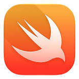</a>

**Native Swift Apps** — Build. Learn. Explore.

<sub>Made by <a href="https://github.com/Miftah-Fentaw">Miftah Fentaw</a>. If it helps you learn, a ⭐ helps others find it.</sub>

</div>
