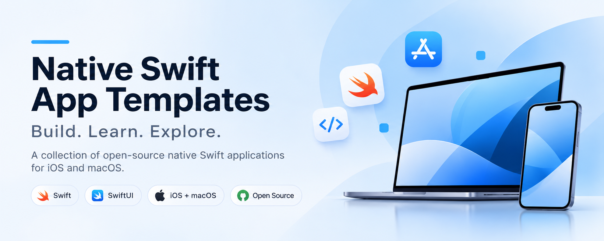
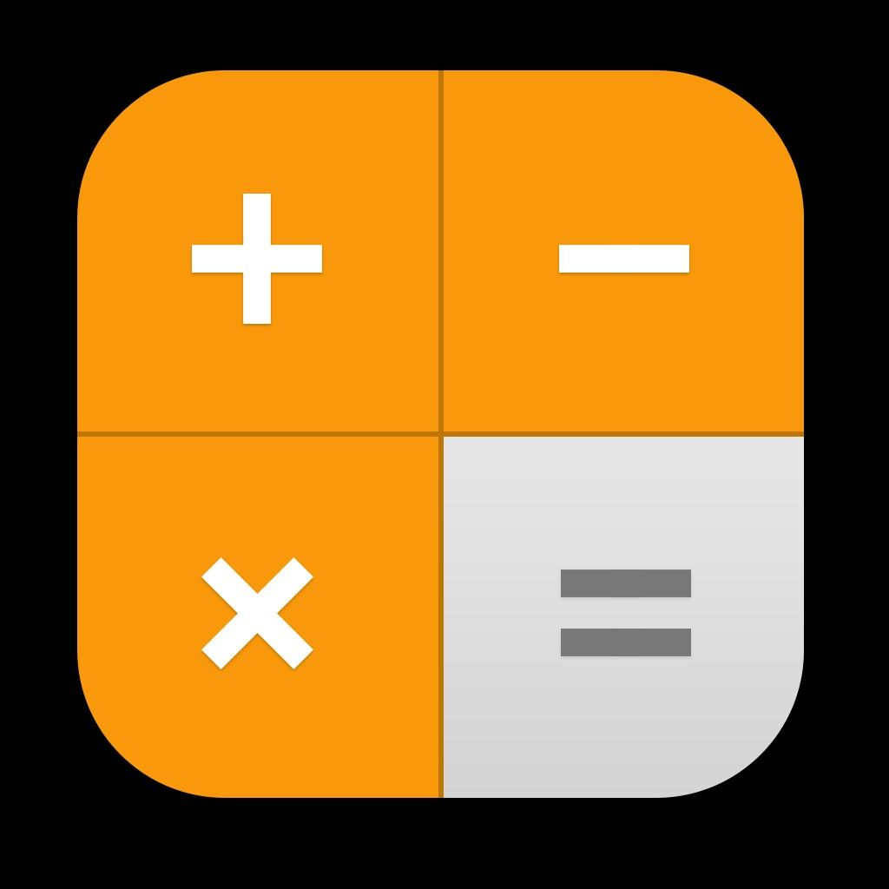
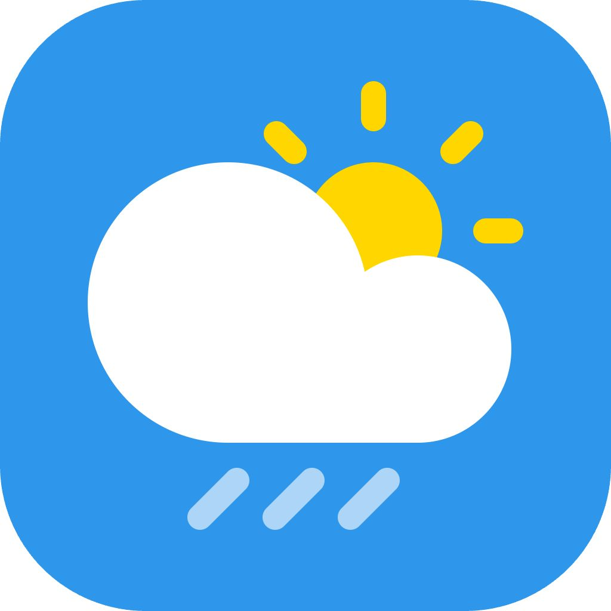

# Native Swift Apps

**Build. Learn. Explore.**

An open-source collection of native Swift and SwiftUI applications for Apple platforms,  
built to help developers learn Apple development through practical projects.


[Overview](#overview)  ·   [Projects](#projects)  ·   [Roadmap](#roadmap)  ·   [Technology](#technology)  ·   [Getting Started](#getting-started)  ·   [Contributing](#contributing)

  


## Overview

Native Swift Apps is a growing collection of self-contained apps built with Swift and SwiftUI. Each project is a complete Xcode project with its own README, so you can learn by reading, running and extending working code.

- **Purpose** — Turn Apple platform concepts into practical, hands-on projects.
- **Audience** — Developers new to Swift, developers moving to Apple platforms from web or Android, and experienced engineers exploring specific frameworks.
- **Focus** — Native Apple development only: Swift, SwiftUI and first-party frameworks, with no third-party dependencies unless a project needs them.

Projects are grouped by difficulty — **Beginner**, **Intermediate** and **Advanced** — so you can start where you are and move up at your own pace.

  


## Projects

<table>
  <tr>
    <td width="56" align="center"><a href="calculator/"></a></td>
    <td>
      <a href="calculator/"><b>SwiftCalc</b></a>&nbsp;
      
      <br>
      <sub>Calculator, tip splitter and unit converter with scientific functions and history.</sub>
    </td>
    <td width="80" align="right"><a href="calculator/README.md"><sub>README&nbsp;→</sub></a></td>
  </tr>
  <tr>
    <td width="56" align="center"><a href="weather/"></a></td>
    <td>
      <a href="weather/"><b>Weather</b></a>&nbsp;
      
      <br>
      <sub>Live conditions, 14-day forecasts, air quality and a map, powered by Open-Meteo.</sub>
    </td>
    <td width="80" align="right"><a href="weather/README.md"><sub>README&nbsp;→</sub></a></td>
  </tr>
</table>

**SwiftCalc:** SwiftUI layout, `@Observable` state, `@AppStorage`, a hand-written expression parser, `Measurement` units, Swift Testing.  
**Weather:** `URLSession` with `async`/`await`, `Codable` JSON decoding, MapKit for SwiftUI, shared `@Observable` state, `UserDefaults` persistence.

  


## Roadmap

These projects are planned and **not yet in the repository**. Names and scope may change; each will get its own folder and README when it lands.

|  SwiftUI fundamentals · Layouts · State |  Persistence · Networking · Native frameworks                                                         |  Concurrency · Multimedia · Architecture                                    |
| ------------------------------------------------------------------------------------------------------------------ | ---------------------------------------------------------------------------------------------------------------------------------------------------------------------------------------- | ------------------------------------------------------------------------------------------------------------------------------------------------------ |
| **TaskFlow** Task management **QuickNotes** Notes and organization **FocusTimer** Pomodoro timer                   | **Spendly** Expense tracking **HabitKit** Habit tracking **QRStudio** QR scanner and generator **VaultKey** Local password manager **Markdown Studio** Markdown editor with live preview | **SwiftChat** AI chat **PixelLab** Image editing **AudioWave** Music player and visualizer **FileNest** File management **Bookly** Appointment booking |

  


## Technology

What the projects in this repository use today:

| Technology | Used for |
| :--- | :--- |
| **Swift** | All app and test code |
| **SwiftUI** | User interfaces |
| **Observation** | `@Observable` app state |
| **Foundation** | Formatting, `Measurement` unit conversion, `UserDefaults` storage, `Codable` JSON |
| **URLSession** | Networking with `async`/`await` (Weather) |
| **MapKit** | Maps in SwiftUI (Weather) |
| **Swift Testing** | Unit tests |
| **XCTest** | UI and launch tests |

Each project's README lists its exact requirements. New frameworks will be added here as projects that use them are added.

  


## Getting Started

Clone the repository, then open a project folder in Xcode.

```bash
git clone https://github.com/Miftah-Fentaw/Native_Swift_Apps.git
```

Each project's README covers its requirements, setup, features and architecture. Start with [SwiftCalc](calculator/README.md) or [Weather](weather/README.md).

### Explore hub website

[`website/`](website/) is a React site that lists every project, its screenshots, features and technology, with search and filters. See its [README](website/README.md) to run it locally.

  


## Contributing

Contributions are welcome — bug fixes, improvements, documentation and new ideas alike.

Please read [CONTRIBUTING.md](CONTRIBUTING.md) and the [Code of Conduct](CODE_OF_CONDUCT.md) before opening an issue or pull request. To report a security issue, follow the [Security Policy](SECURITY.md).

  


## License

This repository is released under the [MIT License](LICENSE).

  


---

**Native Swift Apps** — Build. Learn. Explore.  
Explore the projects, contribute, and star the repository if it helps you learn.
