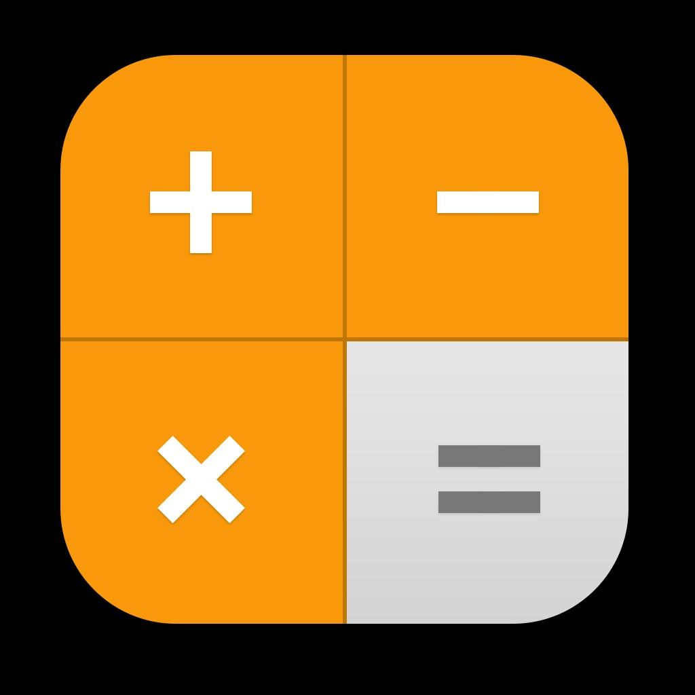
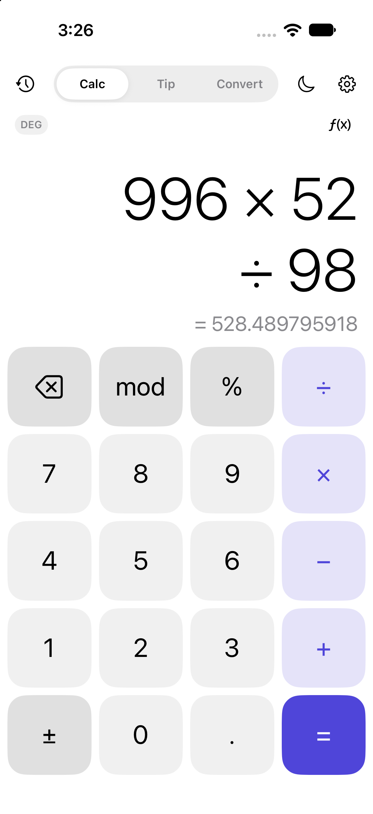
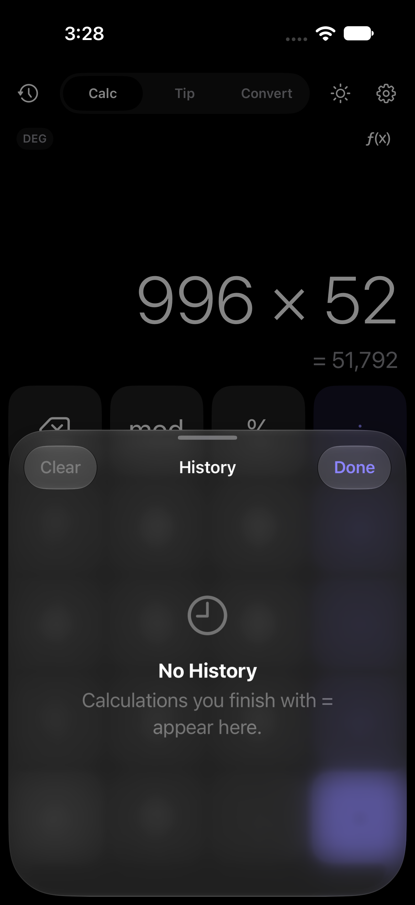
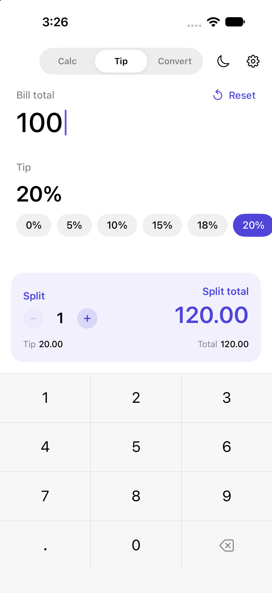
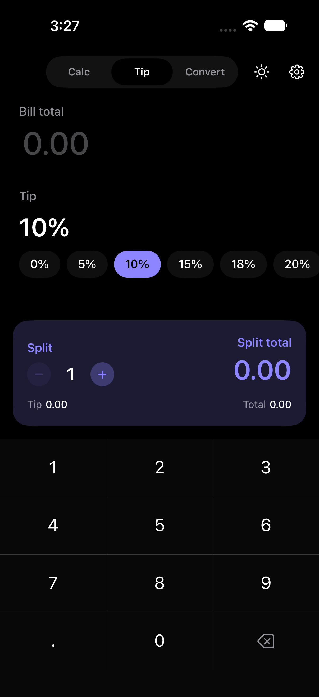
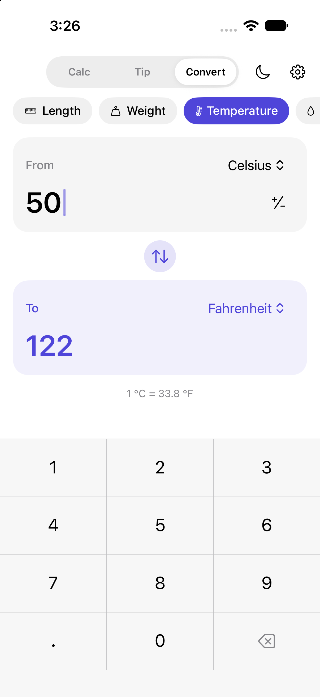
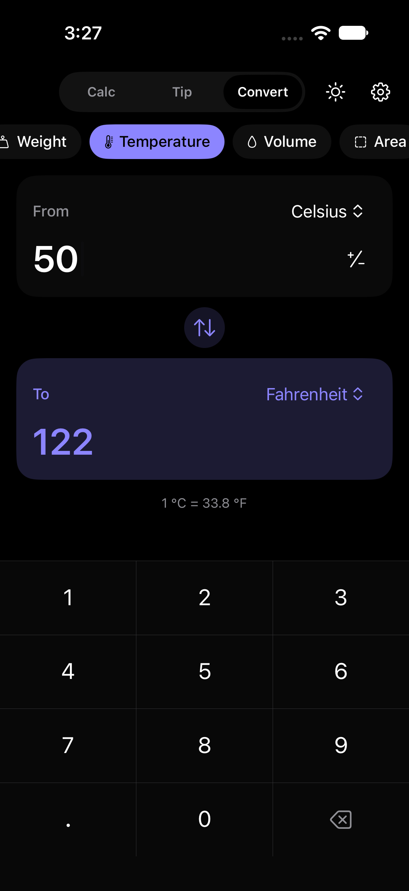
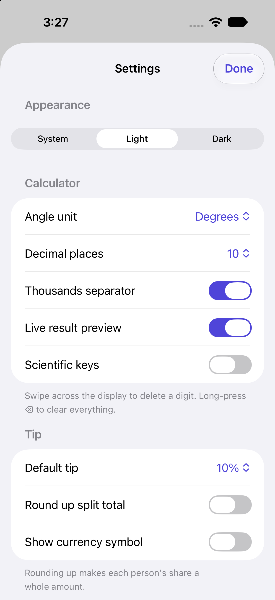
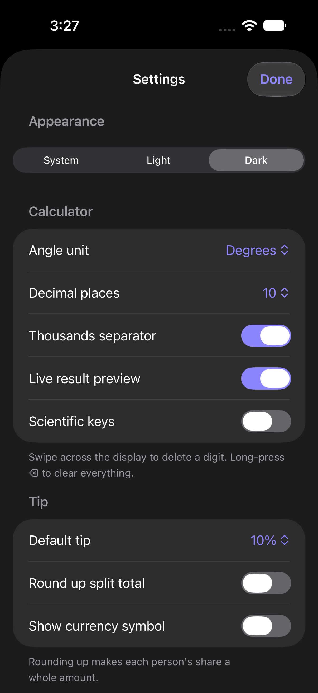

<p align="center">
  
</p>

<h1 align="center">SwiftCalc</h1>

<p align="center">
  <strong>A calculator, tip splitter and unit converter in one native SwiftUI app.</strong>
</p>

<p align="center">
  
  
  
  
  
</p>

<p align="center">
  <a href="#overview">Overview</a>&nbsp;&nbsp;·&nbsp;&nbsp;
  <a href="#screenshots">Screenshots</a>&nbsp;&nbsp;·&nbsp;&nbsp;
  <a href="#features">Features</a>&nbsp;&nbsp;·&nbsp;&nbsp;
  <a href="#usage">Usage</a>&nbsp;&nbsp;·&nbsp;&nbsp;
  <a href="#getting-started">Getting Started</a>&nbsp;&nbsp;·&nbsp;&nbsp;
  <a href="#architecture">Architecture</a>&nbsp;&nbsp;·&nbsp;&nbsp;
  <a href="#testing">Testing</a>
</p>

<p align="center">
  <sub><a href="../README.md">← Back to Native Swift Apps</a></sub>
</p>

<br>

## Overview

SwiftCalc is the first **Beginner** project in [Native Swift Apps](../README.md). It combines three everyday tools behind a single mode switcher:

| Mode | What it does |
| :--- | :--- |
| **Calc** | Standard and scientific calculator with live results, memory and history |
| **Tip** | Bill entry, tip percentage and per-person split |
| **Convert** | Unit conversion across eight categories, built on Foundation's `Measurement` API |

The app uses only SwiftUI and Foundation. There are no third-party packages.

**What you'll learn:** SwiftUI layout and composition, `@Observable` state, `@AppStorage` settings, writing a small expression parser, using Foundation's unit types, and testing logic with Swift Testing.

<br>

## Screenshots

<table>
  <tr>
    <td align="center" width="25%"><br><sub>Calculator · Light</sub></td>
    <td align="center" width="25%"><br><sub>History · Dark</sub></td>
    <td align="center" width="25%"><br><sub>Tip · Light</sub></td>
    <td align="center" width="25%"><br><sub>Tip · Dark</sub></td>
  </tr>
  <tr>
    <td align="center" width="25%"><br><sub>Converter · Light</sub></td>
    <td align="center" width="25%"><br><sub>Converter · Dark</sub></td>
    <td align="center" width="25%"><br><sub>Settings · Light</sub></td>
    <td align="center" width="25%"><br><sub>Settings · Dark</sub></td>
  </tr>
</table>

<br>

## Features

### Calculator

- **Full expressions:** type a whole expression such as `12 × (3 + 4)` instead of one operation at a time.
- **Standard precedence:** parentheses, then `!` and `%`, then powers (right-associative), then unary minus, then `× ÷ mod`, then `+ −`.
- **Live result preview:** shows the result under the expression while you type.
- **Scientific keys,** shown or hidden with the `ƒ(x)` button:
  - `sin`, `cos` and `tan`, plus their inverses through the **2nd** key
  - `ln`, `log`, `eˣ` and `10ˣ`
  - `x²`, `x³`, `xʸ`, `√x`, `∛x`, `1/x`, `|x|` and `x!`
  - the constants `π` and `e`, and `Rand` for a random number
- **Degrees or radians:** switch from the keypad or from Settings.
- **Memory:** `MC`, `MR`, `M+` and `M−`. An **M** indicator shows when memory holds a value.
- **Desk-calculator percent:** `200 + 10%` evaluates to `220`.
- **Typing shortcuts:**
  - Missing closing parentheses are added for you.
  - A number next to a constant or `(` means multiply (`2π` is `2 × π`).
  - Pressing a function key after `=` applies it to the result.
- **Editing:**
  - The clear key works as backspace while you type. Long-press it to clear everything.
  - Swipe across the display to delete the last character.
  - Long-press the display to copy the current value or paste a number.
- **Clear errors:** *Can't divide by zero*, *Undefined* and *Number too large* appear in place of the result.
- **History:**
  - Keeps the last 100 calculations, saved on the device.
  - Tap an entry to reuse its result, swipe to delete it, or long-press to copy the result or the expression.

### Tip

- Type the bill on a dedicated keypad. Amounts are limited to two decimal places.
- Pick a tip from 0% to 25% using quick chips.
- Split the bill between 1 and 50 people. The card shows the tip, the total and each person's share.
- Optionally round each share up, and show the local currency symbol.

### Converter

| Category | Units |
| :--- | :--- |
| Length | m, km, cm, mm, mi, yd, ft, in, nmi |
| Weight | kg, g, mg, t, lb, oz, st |
| Temperature | °C, °F, K |
| Volume | L, mL, m³, gal, qt, pt, cup, fl oz, tbsp, tsp |
| Area | m², km², ft², mi², ac, ha |
| Speed | km/h, m/s, mph, kn |
| Time | s, ms, min, h, d, wk |
| Data | B, bit, KB, MB, GB, TB |

- Swap the two units with one tap.
- A line under the fields shows the rate for one unit (for example `1 m = 3.28084 ft`).
- Negative values are allowed only for temperature.

### App-wide

- **Theme:** System, Light or Dark. Toggle it from the header or choose it in Settings.
- **Haptic feedback** on key presses, which you can turn off.
- **Accessibility labels** on every key, including names for the scientific symbols.

<br>

## Usage

### Gestures and shortcuts

| Where | Action | Result |
| :--- | :--- | :--- |
| Header | Tap the clock icon | Opens calculation history (Calc mode only) |
| Header | Tap the sun / moon icon | Switches between light and dark |
| Calc display | Swipe left or right | Deletes the last character |
| Calc display | Long-press | Copy the current value, or paste a number |
| Calc keypad | Long-press `⌫` | Clears the whole expression |
| Calc keypad | Tap `ƒ(x)` | Shows or hides the scientific keys |
| Scientific keys | Tap `2nd` | Swaps in inverse functions, `eˣ`, `10ˣ`, `x³` and `∛x` |
| History | Tap an entry | Inserts its result into the calculator |
| History | Swipe an entry / long-press it | Delete it / copy result or expression |
| Tip & Convert keypads | Long-press delete | Clears the amount |
| Converter result | Long-press | Copies the converted value |

### Settings

Open Settings with the gear icon. Every setting is saved on the device.

| Section | Setting | Options | Default |
| :--- | :--- | :--- | :--- |
| Appearance | Theme | System, Light, Dark | System |
| Calculator | Angle unit | Degrees, Radians | Degrees |
| Calculator | Decimal places | 2, 4, 6, 8, 10 | 10 |
| Calculator | Thousands separator | On / Off | On |
| Calculator | Live result preview | On / Off | On |
| Calculator | Scientific keys | On / Off | Off |
| Tip | Default tip | 0, 5, 10, 15, 18, 20, 25% | 10% |
| Tip | Round up split total | On / Off | Off |
| Tip | Show currency symbol | On / Off | Off |
| Feedback | Haptics | On / Off | On |
| Data | Clear calculation history | — | — |

<br>

## Getting Started

### Requirements

| | |
| :--- | :--- |
| **Xcode** | A version that includes the iOS 27.2 SDK |
| **Platform** | iOS / iPadOS 27.2 or later (iPhone and iPad) |
| **Dependencies** | None |

### Run the app

1. Clone the Native Swift Apps repository and move into this project:

   ```bash
   git clone https://github.com/Miftah-Fentaw/Native_Swift_Apps.git
   ```

   ```bash
   cd Native_Swift_Apps/calculator
   ```

2. Open the project in Xcode:

   ```bash
   open calculator.xcodeproj
   ```

3. Select the **calculator** scheme and an iPhone or iPad simulator.
4. Press **Run** (`⌘R`).

To run on a physical device, choose your own development team under **Signing & Capabilities** for the `calculator` target.

<br>

## Architecture

```
calculator/
├── calculator/
│   ├── calculatorApp.swift          App entry point; injects the engine and applies the theme
│   ├── Engine/
│   │   ├── CalculatorEngine.swift   @Observable state: tokens, result, memory, history
│   │   ├── ExpressionEvaluator.swift  Recursive-descent parser and math functions
│   │   ├── ExpressionToken.swift    Tokens, operators, functions and keypad keys
│   │   └── NumberFormatting.swift   Raw ↔ display number formatting
│   ├── Models/
│   │   ├── ConversionCategory.swift Converter categories and units
│   │   ├── HistoryEntry.swift       Codable history record
│   │   ├── NumberEntry.swift        Keypad text entry with digit limits
│   │   └── TipCalculator.swift      @Observable tip and split logic
│   ├── Support/
│   │   └── AppSettings.swift        Theme, modes, settings keys, accent color
│   └── Views/
│       ├── ContentView.swift        Header, mode switcher and sheets
│       ├── Calculator/              Calculator, keys and history
│       ├── Tip/                     Tip calculator screen
│       ├── Converter/               Unit converter screen
│       ├── Settings/                Settings form
│       └── Components/              Shared keypad, chips and buttons
├── calculatorTests/                 Swift Testing unit tests
├── calculatorUITests/               XCTest UI and launch tests
└── screenshots/
```

### How it fits together

- **The input is a list of tokens, not a string.** Each key press adds an `ExpressionToken`, such as a number, an operator or a function. This makes it easy to:
  - replace an operator you typed by mistake
  - insert implied multiplication
  - add missing closing parentheses
- **Evaluation is a small recursive-descent parser.** `ExpressionEvaluator` has one function per precedence level. Results are rounded to 12 significant digits, so `0.1 + 0.2` shows as `0.3`.
- **State is `@Observable`.** `CalculatorEngine` is created once in `calculatorApp`, passed down with `.environment(_:)` and read in views with `@Environment`.
- **Settings use `@AppStorage`.** All the keys are in `SettingsKey`, in one place. The engine reads precision and grouping from `UserDefaults` when it evaluates.
- **History is stored as JSON.** `HistoryEntry` values are encoded with `JSONEncoder` and saved in `UserDefaults`.
- **The converter uses Foundation's units.** Each unit wraps a Foundation `Dimension`, and conversion goes through `Measurement`. Days and weeks are custom `UnitDuration` values, because Foundation doesn't define them.

<br>

## Testing

Run all tests in Xcode with **Product → Test** (`⌘U`).

| Suite | Framework | Covers |
| :--- | :--- | :--- |
| `CalculatorEngineTests` | Swift Testing | Typing and evaluation, precedence, power and unary minus, percent, modulo, factorial, parentheses auto-closing, memory, error messages, operator replacement, floating-point cleanup |
| `TipCalculatorTests` | Swift Testing | Tip and split math, rounding up, split limits, decimal and leading-zero handling |
| `calculatorUITests` | XCTest | App launch and launch performance |

<br>

## Notes and Limitations

- **Privacy:** the app makes no network requests. History and settings are stored only in the app's `UserDefaults` on the device.
- **Platforms:** iPhone and iPad only. The app uses UIKit types (`UIColor`, `UIPasteboard`), so it doesn't build for macOS as it is.
- **Number format:** the calculator and converter always use `.` for decimals and `,` for thousands, whatever the device's region. The tip screen's currency symbol follows the device's region.
- **Precision:** calculations use `Double`. Results are rounded to 12 significant digits, and very large or very small values are shown in `E` notation.
- **Limits:** up to 15 digits per number on the calculator, 7 whole digits and 2 decimals for the bill, and 12 whole digits and 6 decimals in the converter.

<br>

## Contributing

Improvements are welcome. Please read the Native Swift Apps [contribution guide](../CONTRIBUTING.md) before opening a pull request, and keep changes inside the `calculator/` folder.

## License

Released under the [MIT License](../LICENSE) as part of Native Swift Apps.

<br>

---

<p align="center">
  <sub>Part of <a href="../README.md"><strong>Native Swift Apps</strong></a> — Build. Learn. Explore.</sub>
</p>
