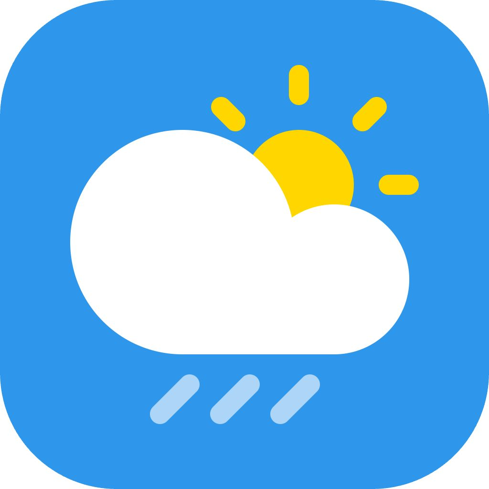
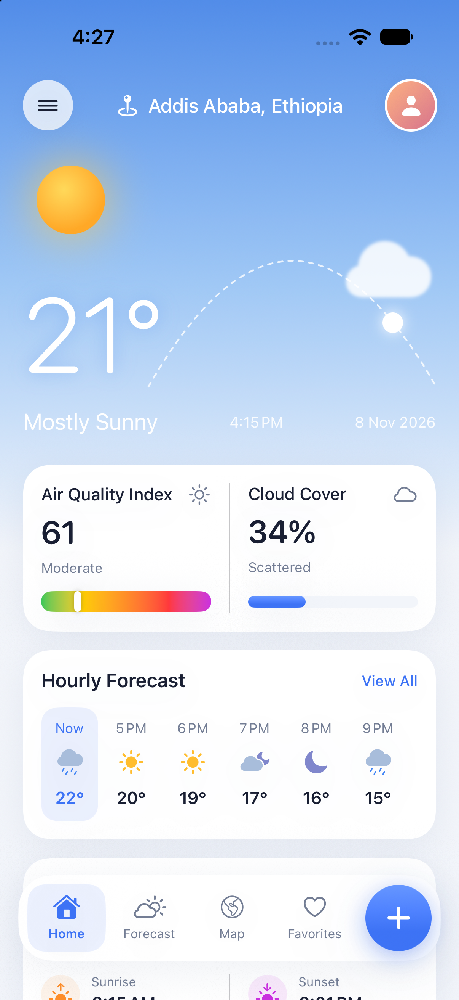
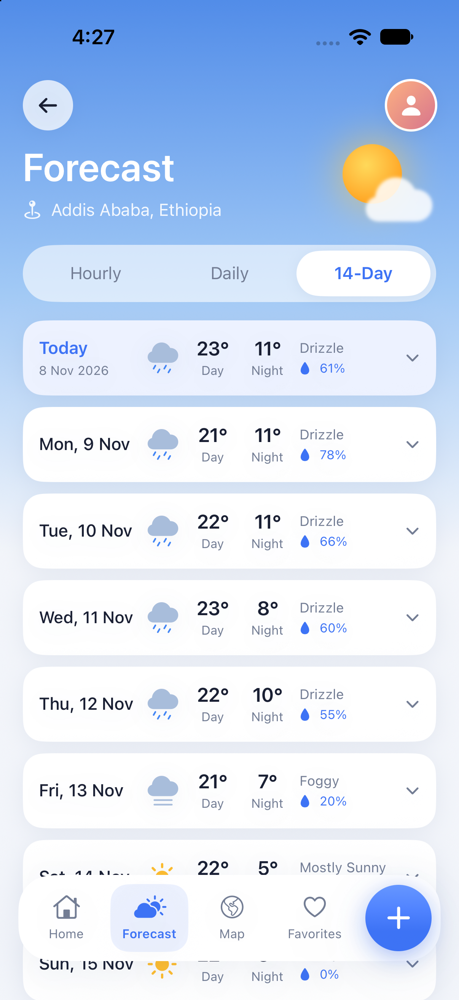
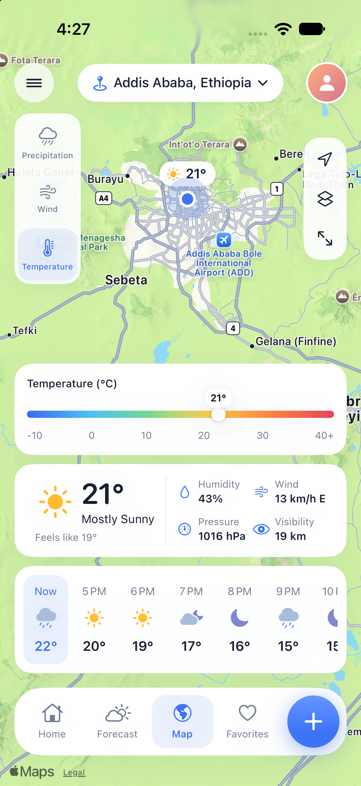
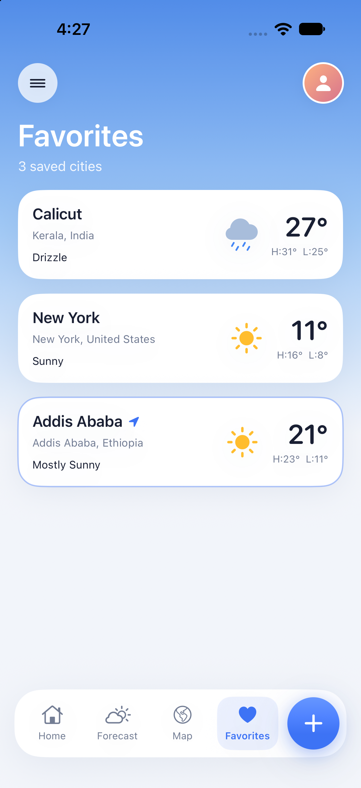
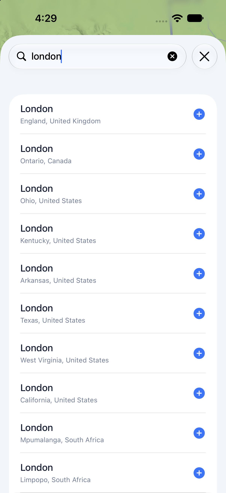
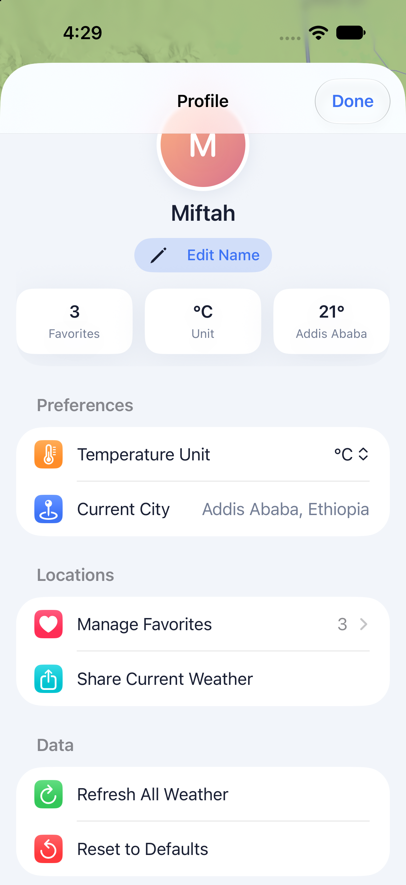

<p align="center">
  
</p>

<h1 align="center">Weather</h1>

<p align="center">
  <strong>Live conditions, hourly and 14-day forecasts, air quality and a map, for any city in the world.</strong>
</p>

<p align="center">
  
  
  
  
  
  
</p>

<p align="center">
  <a href="#overview">Overview</a>&nbsp;&nbsp;·&nbsp;&nbsp;
  <a href="#features">Features</a>&nbsp;&nbsp;·&nbsp;&nbsp;
  <a href="#usage">Usage</a>&nbsp;&nbsp;·&nbsp;&nbsp;
  <a href="#getting-started">Getting Started</a>&nbsp;&nbsp;·&nbsp;&nbsp;
  <a href="#architecture">Architecture</a>&nbsp;&nbsp;·&nbsp;&nbsp;
  <a href="#notes-and-limitations">Notes</a>
</p>

<p align="center">
  <sub><a href="../README.md">← Back to Native Swift Apps</a></sub>
</p>

<br>

## Overview

Weather is a **Beginner** project in [Native Swift Apps](../README.md). It's a SwiftUI weather app built around four tabs:

| Tab | What it shows |
| :--- | :--- |
| **Home** | Current temperature and conditions, the sun's position through the day, air quality, cloud cover, the next hours and key details |
| **Forecast** | Hourly, 7-day and 14-day forecasts, with expandable days |
| **Map** | The selected city on Apple Maps, with a temperature, rain or wind summary |
| **Favorites** | Saved cities with their current weather |

Weather data comes from the free [Open-Meteo](https://open-meteo.com) APIs, so **you don't need an API key or an account**. Clone the project and run it.

**What you'll learn:**
- Networking with `URLSession` and `async`/`await`
- Decoding JSON with `Codable`, and building URLs with `URLComponents`
- Running requests in parallel with `async let`
- Sharing state with `@Observable`
- Saving data in `UserDefaults`
- Using MapKit for SwiftUI
- Building custom tab bars, cards and drawings in SwiftUI

<br>

## Screenshots

<table>
  <tr>
    <td align="center" width="33%"><br><sub>Home</sub></td>
    <td align="center" width="33%"><br><sub>Forecast</sub></td>
    <td align="center" width="33%"><br><sub>Map</sub></td>
  </tr>
  <tr>
    <td align="center" width="33%"><br><sub>Favorites</sub></td>
    <td align="center" width="33%"><br><sub>Search</sub></td>
    <td align="center" width="33%"><br><sub>Profile</sub></td>
  </tr>
</table>

<br>

## Features

### Home

- **Current weather:** a large temperature, the condition, and the local time and date in the city's own time zone.
- **Sun arc:** shows how far the sun has moved between today's sunrise and sunset.
- **Air quality:** the US AQI value and category (Good, Moderate, …) on a colored meter. If air quality data can't be loaded, it shows *Unavailable* and the rest of the screen still works.
- **Cloud cover:** a percentage and a description (Clear, Scattered, Mostly Cloudy, Overcast).
- **Hourly strip:** the next hours, with **View All** to open the hourly forecast.
- **Details:** feels-like temperature, humidity, wind speed and direction, sunrise and sunset.
- **Pull to refresh.**

### Forecast

- **Three views:** Hourly (next 24 hours), Daily (7 days) and 14-Day.
- **Rain chance:** each hour and each day shows its chance of rain.
- **Expandable days:** tap a day to see its sunrise, sunset and UV index.
- **Air quality card:** a summary of today's air quality.

### Map

- **Apple Maps** centered on the selected city, with a pin showing its temperature.
- **Three summaries:** Temperature, Precipitation and Wind. Each shows the city's current value on a colored scale. These aren't map overlays.
- **Map controls:**
  - switch between the standard and satellite views
  - recenter on the city
  - hide the panels to see more of the map
- **City menu:** switch to any of your favorites from the header.

### Favorites and search

- **Search** for any city by name, using Open-Meteo's geocoding service. Search starts after two characters and waits briefly while you type.
- **Add a city** by tapping a search result. This saves it as a favorite and switches to it.
- **Favorites list:** each city shows its condition and today's high and low. Tap one to view it, or long-press to remove it.
- **Manage Favorites** (in Profile): reorder or delete saved cities.

### Profile and preferences

- **Temperature unit:** °C or °F. You can change it from Profile or from the menu in the top-left corner.
- **Name:** an optional name, shown as initials on the avatar.
- **Share:** shares a one-line summary of the current weather.
- **Refresh All Weather:** reloads the selected city and every favorite.
- **Reset to Defaults:** clears your favorites and sets the unit back to Celsius.
- **Data source link:** links to Open-Meteo, and shows the app version.

<br>

## Usage

| Where | Action | Result |
| :--- | :--- | :--- |
| Tab bar | Tap **+** | Opens city search |
| Home / Forecast | Pull down | Reloads weather for the selected city |
| Home | Tap **View All** | Opens the hourly forecast |
| Home / Map | Tap the menu icon (top left) | Change the unit or refresh |
| Any header | Tap the avatar | Opens Profile |
| Forecast | Tap a day | Shows its sunrise, sunset and UV index |
| Map | Tap the city name | Switch to another favorite |
| Favorites | Tap a city | Makes it the selected city and opens Home |
| Favorites | Long-press a city | Remove it from favorites |
| Profile → Manage Favorites | Swipe / drag | Delete or reorder cities |

<br>

## Getting Started

### Requirements

| | |
| :--- | :--- |
| **Xcode** | A version that includes the iOS 27.2 SDK |
| **Platform** | iOS / iPadOS 27.2 or later (iPhone and iPad) |
| **Network** | An internet connection for weather data |
| **Dependencies** | None. No API key needed. |

### Run the app

1. Clone the repository and move into this project:

   ```bash
   git clone https://github.com/Miftah-Fentaw/Native_Swift_Apps.git
   ```

   ```bash
   cd Native_Swift_Apps/weather
   ```

2. Open the project in Xcode:

   ```bash
   open weather.xcodeproj
   ```

3. Select the **weather** scheme and an iPhone or iPad simulator.
4. Press **Run** (`⌘R`).

On first launch the app shows **Calicut, Kerala**. Use **+** to search for and add your own cities.

To run on a physical device, choose your own development team under **Signing & Capabilities** for the `weather` target.

<br>

## Architecture

```
weather/
├── weather/
│   ├── weatherApp.swift            App entry point; creates the store and injects it
│   ├── ContentView.swift           Tab switching, floating tab bar, Add City sheet
│   ├── Models/
│   │   ├── WeatherModels.swift     City, conditions, forecasts, air quality, report
│   │   └── SampleData.swift        Static report used by SwiftUI previews
│   ├── Services/
│   │   └── WeatherService.swift    Open-Meteo requests and JSON → model mapping
│   ├── Store/
│   │   └── WeatherStore.swift      @Observable app state, caching and persistence
│   └── Views/
│       ├── HomeView.swift
│       ├── ForecastView.swift
│       ├── WeatherMapView.swift
│       ├── FavoritesView.swift
│       ├── AddCityView.swift
│       ├── ProfileView.swift
│       └── Components/             Tab bar, cards, sky drawings, icons, theme
├── weatherTests/                   Unit test target
└── weatherUITests/                 UI and launch tests
```

### How it fits together

- **`WeatherService`** is a small struct that wraps `URLSession`. It calls three Open-Meteo endpoints:

  | Endpoint | Used for |
  | :--- | :--- |
  | `api.open-meteo.com/v1/forecast` | Current conditions, 24 hourly and 14 daily values |
  | `air-quality-api.open-meteo.com/v1/air-quality` | Current US AQI |
  | `geocoding-api.open-meteo.com/v1/search` | City search |

  Forecast and air quality are requested together with `async let`. If the air quality request fails, the report still loads without it.

- **Response models** are private `Decodable` structs with explicit `CodingKeys`. They're mapped into the app's own types: `WeatherReport`, `CurrentConditions`, `HourlyForecast` and `DailyForecast`.
- **WMO weather codes** from Open-Meteo are turned into a `WeatherCondition`. Each condition has a label and an SF Symbol, with separate day and night versions.
- **Time zones:** Open-Meteo returns times without a UTC offset, so they're read and shown in the city's own time zone, not the device's.
- **`WeatherStore`** is the single `@Observable` source of truth. It's created in `weatherApp` and shared with `.environment(_:)`. It:
  - skips a reload if the data is less than 10 minutes old (pull to refresh always reloads)
  - ignores a response that arrives after you've switched to another city
  - caches reports for favorite cities
- **Saved data:** the selected city, favorites and unit are stored as JSON in `UserDefaults`. Your name is stored with `@AppStorage`.
- **Temperatures** are always fetched in Celsius and converted to Fahrenheit for display when needed.
- **Previews** use `WeatherStore.preview` and `WeatherReport.sample`, so SwiftUI previews work without a network connection.

<br>

## Testing

Run tests in Xcode with **Product → Test** (`⌘U`).

| Target | Framework | Status |
| :--- | :--- | :--- |
| `weatherTests` | XCTest | Xcode template only, no app-specific tests yet |
| `weatherUITests` | XCTest | App launch and launch performance |

Good first contributions here: unit tests for `WeatherCondition(code:)`, `AirQuality` categories, `compassDirection` and `WeatherStore` temperature conversion.

<br>

## Notes and Limitations

- **Light appearance only:** the app is designed for light mode and doesn't change in dark mode.
- **No device location:** the app doesn't use Core Location. You pick cities by searching.
- **Map summaries:** the Temperature, Precipitation and Wind views show the selected city's current value on a legend. They aren't live radar or map overlays.
- **Wind** is always shown in km/h.
- **Network use:** weather requests send only city coordinates, and search requests send only the text you type, to Open-Meteo. Nothing else leaves the device.
- **Data terms:** Open-Meteo is free for non-commercial use. Check their [terms](https://open-meteo.com/en/terms) before using this code in a commercial app.
- **Platforms:** iPhone and iPad only.

<br>

## Contributing

Improvements are welcome. Please read the [contribution guide](../CONTRIBUTING.md) before opening a pull request, and keep changes inside the `weather/` folder.

## License

Released under the [MIT License](../LICENSE) as part of Native Swift Apps. Weather data is provided by [Open-Meteo](https://open-meteo.com).

<br>

---

<p align="center">
  <sub>Part of <a href="../README.md"><strong>Native Swift Apps</strong></a> — Build. Learn. Explore.</sub>
</p>
